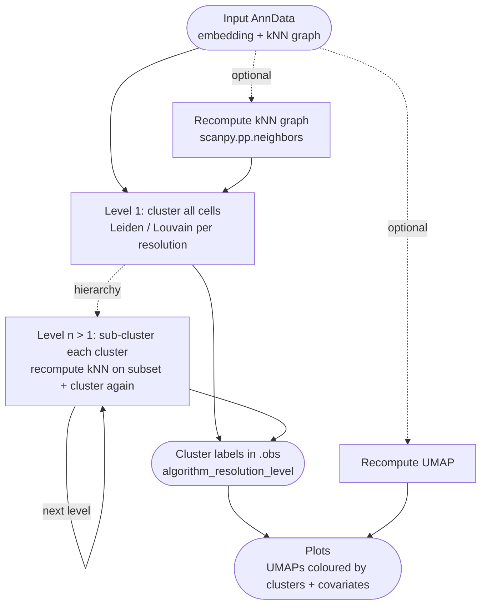

# Clustering

This module provides a workflow to perform clustering at multiple resolutions and at multiple subclustering levels (iterative sub-clustering).
The code is optimised for memory efficiency and speed, allowing for clustering of large datasets.



*Conceptual overview of the main steps of the module. See the [functional description](#functional-description) below for details.*

## Configuration

Example configuration for clustering can be found in `workflow/clustering/test/config.yaml` showcasing the setup for hierarchical (iterative) sub-clustering.

```yaml
DATASETS:

  test_level1_multiresolution:
    input:
      clustering: test/input/pbmc68k.h5ad
    clustering:
      recompute_umap: true
      recompute_neighbors: true
      neighbors:
        n_neighbors: 30
        use_rep: X_pca
      algorithm:
        - leiden
        # - louvain
      resolutions:
        - 0.2
        - 0.3
        - 0.4
      umap_colors:
        - bulk_labels
        - batch
        
  test_hierarchical:
    input:
      clustering: test/input/pbmc68k.h5ad
    clustering:
      neighbors_key: neighbors
      algorithm: leiden
      resolutions:
        - 0.5
      hierarchy:
        1: 0.1
        3: 0.2
      umap_colors:
        - bulk_labels
        - batch
        - n_genes
        
  test_hierarchical_int:
    input:
      clustering: test/input/pbmc68k.h5ad
    clustering:
      neighbors_key: neighbors
      algorithm: leiden
      use_gpu: true
      resolutions:
        - 0.5
      hierarchy: 3
      umap_colors:
        - bulk_labels
        - batch
```

## Parameters

### Clustering Parameters

- **`algorithm`**: Clustering algorithm to use
  - Single algorithm: `leiden` or `louvain`
  - Multiple algorithms: List of algorithms (e.g., `[leiden, louvain]`)

- **`resolutions`**: List of clustering resolutions to test
  - Example: `[0.2, 0.4, 0.8, 1.0, 1.6]`

- **`neighbors_key`**: Key for pre-computed neighbors in `adata.uns`
  - Default: Uses existing neighbors if available

- **`hierarchy`**: Configuration for iterative sub-clustering
  - Dictionary format: `{level: resolution}` (e.g., `{1: 0.1, 3: 0.2}`); levels up to the largest key are computed, levels missing from the dictionary use the value from `resolutions`
  - Integer format: Maximum hierarchy depth (e.g., `3`)

### Neighbor Computation

- **`recompute_neighbors`**: Boolean flag to recompute neighbors
  - `true`: Force recomputation of neighbors
  - `false` (default): Use existing neighbors if available

- **`neighbors`**: Parameters for neighbor computation when recomputing
  - `n_neighbors`: Number of neighbors (e.g., `30`)
  - `use_rep`: Representation to use (e.g., `X_pca`)

### UMAP Configuration

- **`recompute_umap`**: Boolean flag to recompute UMAP embedding
  - `true`: Force recomputation of UMAP
  - `false` (default): Use existing UMAP if available

- **`umap_colors`**: List of metadata columns to use for UMAP coloring
  - Example: `[bulk_labels, batch, n_genes]`

### Performance Options

- **`use_gpu`**: Boolean flag to enable GPU acceleration
  - `true`: Use GPU for clustering when available
  - `false` (default): Use CPU only

- **`n_cell_cpu`**: Threshold for forcing CPU computation - CPU is used when dataset has fewer than this many cells (default: 100000)

## Calling the clustering script from the command line

The clustering script is located at `workflow/clustering/scripts/clustering.py` and performs single-level clustering operations. For hierarchical clustering, you need to run the script multiple times in sequence.

The script automatically detects GPU availability and uses RAPIDS when possible for accelerated clustering. It falls back to scanpy implementation when needed.

Make sure you are using the `envs/scanpy.yaml` environment, which has all the necessary dependencies installed.

Check the help message for the script to see all available options:

```bash
python workflow/clustering/scripts/clustering.py -h
```

```
usage: clustering.py [-h] [--resolution RESOLUTION] [--algorithm {louvain,leiden}] [--level LEVEL] [--threads THREADS] [--overwrite] [--max_cluster_factor MAX_CLUSTER_FACTOR] [--clustering_args CLUSTERING_ARGS] [--neighbors_key NEIGHBORS_KEY] [--neighbors_args NEIGHBORS_ARGS] [--n_cell_cpu N_CELL_CPU]
                     input_file output_file

Run clustering on anndata file.

positional arguments:
  input_file            Input anndata file (.h5ad or .zarr)
  output_file           Output anndata file (.zarr)

options:
  -h, --help            show this help message and exit
  --resolution RESOLUTION
                        Clustering resolution (default: 1.0)
  --algorithm {louvain,leiden}
                        Clustering algorithm (default: leiden)
  --level LEVEL         Hierarchical clustering level (default: 1)
  --threads THREADS     Number of threads for parallel processing (default: 1)
  --overwrite           Overwrite existing clustering results
  --max_cluster_factor MAX_CLUSTER_FACTOR
                        Maximum cluster factor for heuristic check (default: 50)
  --clustering_args CLUSTERING_ARGS
                        Additional clustering arguments as JSON string
  --neighbors_key NEIGHBORS_KEY
                        Key for neighbors in adata.uns (default: neighbors)
  --neighbors_args NEIGHBORS_ARGS
                        Arguments for neighbors computation as JSON string
  --n_cell_cpu N_CELL_CPU
                        Force CPU when dataset has fewer than this many cells (default: 100000)
```

## Script Behavior

### Level 1 Clustering
For `--level 1`, the script:
1. Reads the input file with existing neighbors graph
2. Applies clustering using the specified algorithm and resolution
3. Outputs a zarr file containing only the clustering results in `.obs`

### Hierarchical Clustering (Level > 1)
For `--level > 1`, the script:
1. Reads clustering results from the previous level
2. Recomputes neighbors for each cluster separately using parallel processing
3. Applies sub-clustering within each cluster
4. Combines results with hierarchical naming (e.g., `cluster_subcluster`)

### GPU/CPU Handling
- Automatically detects NVIDIA GPU availability
- Uses RAPIDS implementation when GPU is available and beneficial
- Falls back to scanpy for small datasets (< `n_cell_cpu` cells)
- Includes a heuristic check on the number and size of GPU clusters, falling back to the scanpy (CPU) implementation if it fails

### Output Format
- Creates zarr-linked output preserving the original data structure
- Only writes the new clustering column to minimize storage
- Clustering results are named as `{algorithm}_{resolution}_{level}`

## Examples

### Basic clustering at level 1:
```bash
python workflow/clustering/scripts/clustering.py \
    input.h5ad \
    output_level1.zarr \
    --resolution 1.0 \
    --algorithm leiden
```

### Hierarchical clustering at level 2:
```bash
# First run level 1
python workflow/clustering/scripts/clustering.py \
    input.h5ad \
    output_level1.zarr \
    --resolution 1.0 \
    --level 1

# Then run level 2 (requires level 1 results)
python workflow/clustering/scripts/clustering.py \
    output_level1.zarr \
    output_level2.zarr \
    --resolution 0.5 \
    --level 2 \
    --threads 4 \
    --neighbors_args '{"n_neighbors": 15, "use_rep": "X_pca"}'
```

### Using custom clustering parameters:
```bash
python workflow/clustering/scripts/clustering.py \
    input.h5ad \
    output.zarr \
    --resolution 0.8 \
    --clustering_args '{"n_iterations": 5, "flavor": "igraph"}' \
    --overwrite
```

## Output Structure

Each run produces a single clustering result column:
- **Level 1**: `leiden_1.0_1` (algorithm_resolution_level)
- **Level 2**: `leiden_1.0_2` (inherits resolution from level 1)

To collect multiple clustering results, read and combine the `.obs` columns:

```python
import pandas as pd
from utils.io import read_anndata

# Combine results from multiple runs
obs_data = []
for file in ['output_level1.zarr', 'output_level2.zarr']:
    obs = read_anndata(file, obs='obs', verbose=False).obs
    obs_data.append(obs)

combined_obs = pd.concat(obs_data, axis=1)
```


## Functional description

### Inputs

* **File formats:** `.h5ad` or `.zarr` (AnnData), configured under `input: clustering:` (see [architecture](https://scatlastb.readthedocs.io/en/latest/principles/architecture.html)).
* **Neighbour graph (level 1):** `.uns[<neighbors_key>]` (config `neighbors_key`, default `neighbors`) is read to look up `connectivities_key`/`distances_key` (defaults `connectivities`/`distances`); the corresponding `.obsp` matrices are loaded. If `recompute_neighbors: true`, the graph is first recomputed (see step 1) and read from that intermediate file instead.
* **Embedding (levels > 1):** `.obsm[use_rep]`, where `use_rep` is taken from config `neighbors.use_rep` (default `X_pca`). If that key is absent from `.obsm`, `use_rep` is taken from `.uns/neighbors/params/use_rep`; the script fails if neither exists.
* **UMAP:** `.obsm['X_umap']` of the input is used for plotting unless `recompute_umap: true`.
* **Plot covariates:** `.obs` columns listed in `umap_colors` (and `plots.colors`, `plots.plot_centroids`).
* The parameter space is expanded per dataset over `algorithm` (allowed: `leiden`, `louvain`; anything else fails at DAG construction) × `resolutions` × hierarchy `level`. `hierarchy` is parsed by `ClusteringConfig.py`:
  * not set → only level 1;
  * integer `n` (or string) → levels `1..n`, all with the same resolution;
  * list → levels `1..len(list)` (list values are ignored);
  * dict `{level: value}` → levels `1..max(key)`; a scalar value overrides the clustering resolution at that level, a dict value is passed as extra clustering keyword arguments; levels not in the dict use the `resolutions` value.

### Processing steps

1. **`clustering_compute_neighbors`** (preprocessing script `neighbors.py`, environment `scanpy`, or `rapids_singlecell` when global `use_gpu: true`). Only scheduled if `recompute_neighbors: true`. Reads `obs`, `obsm`, `uns`, `var`; if `use_rep` is unset, uses `X_pca` (with `n_pcs` = all PCs) when present, otherwise `X`; computes PCA if `X_pca` is requested but missing. Sets `n_neighbors = min(n_neighbors (default 15), n_obs)` and calls `scanpy.pp.neighbors(**neighbors)` (or the `rapids_singlecell` equivalent, falling back to scanpy on error). Writes `obsp` and `uns` to `neighbors/<wildcards>.zarr`.

2. **`clustering_cluster`** (script `scripts/clustering.py`, environment `scanpy` or `rapids_singlecell` when dataset-level `use_gpu: true`). One job per dataset × file_id × algorithm × resolution × level; level `L > 1` depends on the output of level `L-1`. Threads = `4·level − 3`.
   ```text
   cluster_key = f"{algorithm}_{resolution}_{level}"      # resolution = wildcard value
   kwargs      = {resolution, key_added=cluster_key} | hierarchy kwargs for this level
   if "flavor" in kwargs: force CPU (scanpy)
   cpu_kwargs  = {flavor: kwargs.pop("flavor", "igraph")}  (+ n_iterations: pop(..., 2) for leiden)
   GPU = nvidia-smi succeeds and rapids_singlecell is importable
   if cluster_key already in input .obs and not overwrite (default overwrite=True): reuse it
   elif level == 1:
       read obs, uns (+ obsm for .h5ad); load obsp graph selected via neighbors_key
       apply_clustering(adata)
   else:
       prev_key = f"{algorithm}_{resolution}_{level-1}"
       for each cluster c of prev_key, in parallel (joblib, n_jobs=threads):
           sub = cells with prev_key == c
           if sub.n_obs < 2 * n_neighbors (default 15):
               label = f"{c}_{last '_'-component of c}"       # cluster is not split
           else:
               neighbors(sub, **neighbors_args)              # recompute kNN on obsm[use_rep]
               apply_clustering(sub)
               label = f"{c}_{subcluster}"
       collect labels into obs[cluster_key]
   write only obs[cluster_key] (zarr-linked to the input)
   ```
   `apply_clustering` calls `rapids_singlecell.tl.leiden/louvain` on GPU (after casting `connectivities` to `float64`) or `scanpy.tl.leiden/louvain(flavor='igraph', n_iterations=2)` on CPU. If the (sub)set has fewer than `n_cell_cpu` cells (default 100,000) the scanpy implementation is used even on GPU (note: in that case `cpu_kwargs` are only applied if the job runs without GPU). After GPU clustering, a sanity heuristic is evaluated: with `max_clusters = max(1, int(50·resolution))`, if the number of clusters exceeds `max_clusters` and neither the 10% quantile of cluster sizes exceeds `n_obs / max_clusters` nor the smallest cluster has more than 10 cells, clustering is recomputed with the scanpy implementation and `cpu_kwargs`. Retries of GPU jobs are moved to CPU resources from attempt 2.

3. **`clustering_compute_umap`** (preprocessing script `umap.py`, environment `scanpy` / `rapids_singlecell`). Only scheduled if `recompute_umap: true`; uses the neighbour graph from step 1 (if recomputed) or the input file. Ensures `.uns[neighbors_key]` has keys and `params` (`use_rep` default `X_pca`, `n_neighbors` inferred from the distance matrix if missing), loads/computes the representation (PCA with 50 components if `X_pca` is missing), then `scanpy.tl.umap(init_pos='random', neighbors_key=...)`. On GPU, distances are used as connectivities (cuML workaround) and outlier coordinates are trimmed. Writes `obsm/X_umap` and `uns`.

4. **`clustering_merge`** (script `scripts/merge.py`, environment `scanpy`). Reads `.obs` of all level/algorithm/resolution outputs for one file, joins them on cell index and adds them to the `.obs` of the base file (the UMAP file from step 3 if `recompute_umap`, otherwise the input file). Sets `.uns['clustering'] = {'neighbors_key': ...}` and writes `obs` and `uns`, linking all other slots.

5. **`clustering_plot_umap`** (preprocessing script `plot.py`, environment `scanpy`). Plots `X_umap` coloured by `umap_colors` + `plots.colors` + all cluster keys; cluster keys (and `plots.plot_centroids`) are drawn with numbered centroid labels. Columns with ≤1 unique value are skipped; categories with ≤ 0.01% of cells are removed; colours not in `.obs` are interpreted as gene names.

6. **`clustering_plot_evaluation`** (script `scripts/plot_enrichment.py`, environment `scanpy`; not part of the default `all` target, run via `plot_evaluation_all`). For every cluster key × covariate in `umap_colors`: categorical covariates (≤100 categories) → stacked proportion bar plot per cluster titled with the normalised mutual information (`sklearn.metrics.normalized_mutual_info_score`, NaN rows dropped); numeric covariates → violin plot per cluster. Runs in a thread pool (1–10 threads).

### Outputs

Relative to `<output_dir>/clustering/`:

* `dataset~<dataset>/file_id~<file_id>.zarr` — final object; `.obs` gains one categorical column per `<algorithm>_<resolution>_<level>` (level > 1 labels are `_`-joined paths such as `3_0_2`), `.uns['clustering']['neighbors_key']`; with `recompute_umap`, also `.obsm['X_umap']`.
* `resolutions/dataset~<dataset>/file_id~<file_id>/algorithm~<a>/resolution~<r>/level~<l>.zarr` — per-run intermediate with a single `.obs` column.
* `neighbors/…zarr`, `umap/…zarr` — intermediates when recomputation is requested.

Relative to `<images>/clustering/dataset~<dataset>/file_id~<file_id>/`:

* `umap/<color>.png` — UMAPs per colour/cluster key.
* `evaluation/<cluster_key>--<covariate>.png` — stacked bar (with NMI) or violin plots.

### Environments

* [`scanpy`](https://github.com/HCA-integration/scAtlasTb/blob/main/envs/scanpy.yaml) — clustering on CPU, merge, plots.
* [`rapids_singlecell`](https://github.com/HCA-integration/scAtlasTb/blob/main/envs/rapids_singlecell.yaml) — GPU clustering (dataset-level `use_gpu: true`), and neighbours/UMAP recomputation when the global `use_gpu: true`.
