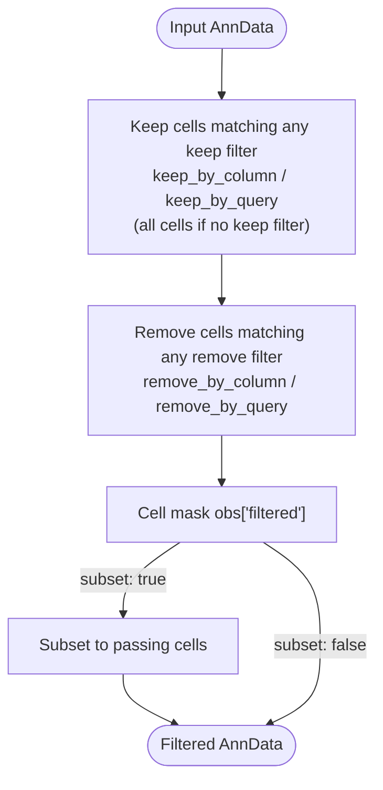

# Filtering

This workflow filters the input data based on a set of conditions.
The conditions can be defined in the config under the `filter` module.



*Conceptual overview of the main steps of the module. See the [functional description](#functional-description) below for details.*

## Configuration

```yaml
DATASETS:
  Lee2020:
    input:
      filter: test/input/load_data/harmonize_metadata/Lee2020.zarr
    filter:
      subset: true ## whether to subset the file according to the filters
      remove_by_column:
        donor: # column name
          # entries from column to exclude (will be treated as String)
          - C19-CB-0008 # value not in data
          - Normal 1
          - nCoV 1
          - Flu 1
      keep_by_column:
        sex:
          - female
      remove_by_query:
        # pandas query strings for complex filtering conditions
        - 'random < 3'
      keep_by_query:
        # pandas query strings for cells to keep
        - 'disease == "influenza"'
  test:
    input:
      filter: test/input/pbmc68k.h5ad
    filter:
      subset: true
      remove_by_column:
        phase:
          - G1
        is_cd14_mono:
          - true
```

## Parameters

- **`subset`**: Boolean flag that determines whether to physically subset the file according to the filters
  - `true` (default): Creates a new subset file with filtered data
  - `false`: Only applies filters without modifying the original file structure

- **`write_copy`**: Boolean flag for output format when subsetting
  - `true`: Writes a full copy of the data
  - `false` (default): Writes linked zarr format when possible

- **`remove_by_column`**: Dictionary defining filtering conditions
  - Keys: Column names in the AnnData observation metadata (`adata.obs`)
  - Values: List of entries to exclude from that column
  - All entries are treated as strings for comparison

- **`keep_by_column`**: Dictionary defining columns and entries to retain
  - Keys: Column names in the AnnData observation metadata (`adata.obs`)
  - Values: List of entries to keep from that column
  - All entries are treated as strings for comparison

- **`remove_by_query`**: List of pandas query strings for complex filtering conditions
  - Each query string follows pandas DataFrame query syntax
  - Cells matching these queries will be removed

- **`keep_by_query`**: List of pandas query strings for cells to retain
  - Each query string follows pandas DataFrame query syntax
  - Only cells matching these queries will be kept

## Behavior

- All `remove_by` filtering conditions are combined with **AND** logic - a cell must pass ALL filters to be retained
  - Within `remove_by_column`: cells are excluded if they match ANY value in ANY specified column
  - Within `remove_by_query`: cells are excluded if they match ANY of the query conditions
- All `keep_by` filtering conditions are combined with **OR** logic - a cell only needs to pass ONE filter to be retained
  - Within `keep_by_column`: cells are retained if they match ANY value in ANY specified column
  - Within `keep_by_query`: cells are retained only if they match ANY of the query conditions
- The final mask keeps cells that:
  1. If `keep_by` filters are specified: DO match at least ONE condition from `keep_by_column` OR `keep_by_query`, AND
  2. Do NOT match any values in `remove_by_column` columns, AND
  3. Do NOT match any `remove_by_query` conditions.
  
  If no `keep_by` filters are specified, all cells are initially kept and only `remove_by` filters are applied.

## Functional description

### Inputs

- One AnnData file per `file_id` (`.zarr` or `.h5ad`), resolved from `input: filter:` (see [architecture](https://scatlastb.readthedocs.io/en/latest/principles/architecture.html)).
- Only `obs` is used to build the filter mask; all other slots are passed through (linked, or copied/subset when subsetting).
  The file is opened with `read_anndata(..., dask=True, backed=True)`, so matrices are not loaded into memory unless a copy is written.
- Config keys (per task, see [Configuration](#configuration) and [Parameters](#parameters)) and the defaults applied in the Snakefile:
  `subset` (default `true`), `write_copy` (default `false`; forced to `true` if the input is `.h5ad`),
  `keep_by_column` (default `{}`), `keep_by_query` (default empty), `remove_by_column` (default `{}`),
  `remove_by_query` (default empty).
  The key `dask` is accepted in the config but not used by the script.

### Processing steps

1. **`filter_filter`** (script `scripts/filter.py`, environment `scanpy`), one job per `dataset` × `file_id`:

   ```text
   has_keep = keep_by_column or keep_by_query
   mask = all False if has_keep else all True           # one entry per cell
   for column, values in keep_by_column:                # OR over all keep filters
       mask |= obs[column].astype(str).isin(str(v) for v in values)
   for query in keep_by_query:
       mask |= obs.eval(query)
   for column, values in remove_by_column:              # AND NOT over all remove filters
       mask &= ~obs[column].astype(str).isin(str(v) for v in values)
   for query in remove_by_query:
       mask &= ~obs.eval(query)
   obs['filtered'] = mask
   subset = subset and (at least one cell has mask == False)
   ```

   - Column filters compare string representations (`astype(str)`), so e.g. `true` in the config matches the boolean `True`
     in `obs`, and numeric values match their string form.
   - Query filters are evaluated with `pandas.DataFrame.eval` on `obs` and must return a boolean per cell.
   - Keep filters are applied before remove filters, so a cell matching both a keep and a remove filter is removed.
   - If no cell is removed, the subsetting step is skipped even when `subset: true`.
   - Writing:
     - `subset` false (or nothing removed): `write_zarr_linked(..., files_to_keep=['obs'])`: only `obs` (with the new
       `filtered` column) is written, all other slots are linked to the input.
     - `subset` true and `write_copy` true (or `.h5ad` input): `adata[obs['filtered']].copy()` is written as a full zarr
       copy (`write_zarr(..., compute=True)`).
     - `subset` true and `write_copy` false: only the subset `obs` is written. The other slots are linked to the input
       zarr together with the cell mask (`subset_mask=(mask, None)`), which `read_anndata` applies when the file is read.

### Outputs

- `<output_dir>/filter/dataset~{dataset}/file_id~{file_id}.zarr`: AnnData with `obs['filtered']` (bool, `True` = cell
  passed all filters). Without subsetting, the output keeps all cells and slots of the input. If subsetting was applied, the object only contains the cells with `filtered == True`.

### Environments

- [`scanpy`](https://github.com/HCA-integration/scAtlasTb/blob/main/envs/scanpy.yaml)
