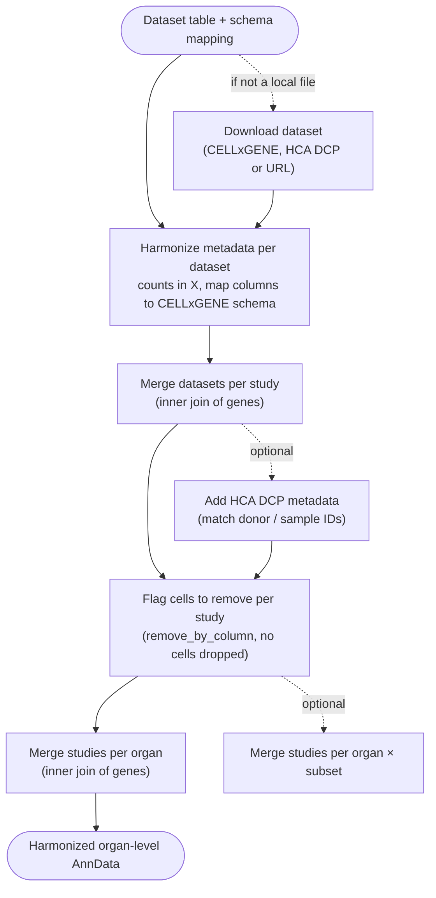

# Data loading



*Conceptual overview of the main steps of the module. See the [functional description](#functional-description) below for details.*

## Workflow

Given a TSV file and a schema mapping, the pipeline does the following:

1. [Load data from CELLxGENE, DCP, URL or file](#load-data)
2. [Aggregate metadata](#aggregate-metadata)
3. [Merge datasets per study, organ or custom subset](#merge-data)
4. [Filter cells](#filter)

Examples of configuration files are under `test/configs/` (e.g. `test/configs/cellxgene.yaml` and `test/configs/dataset_info/cellxgene.tsv`).
By default, dataset configurations are available under `configs` at the top-level pipeline (git root of this repository), but they can be modified or replaced by custom files.

### Load data

Files can either be read from a specified input file or downloaded from an URL, CELLxGENE or DCP directly.
Which way a dataset is loaded, depends on the [dataset definition file](#dataset-definition-file).

### Aggregate Metadata

The `harmonize_metadata` rule adds additional dataset-level information that is included from the input TSV file.
This steps expects the data to follow
the [CELLxGENE schema 3.0.0](https://github.com/chanzuckerberg/single-cell-curation/blob/main/schema/3.0.0/schema.md)
and is extended as described below.
Other steps include:

+ adding external annotations if annotation file and columns are available in the TSV
+ saving donor IDs under `.obs['donor']`
+ building a technical sample ID from the columns listed in `tech_id` and saving it under `.obs['tech_id']` and `.obs['sample']`

The input `AnnData` objects must contain:

+ `.X` raw counts, sparse format
+ `.obs` columns from the schema defined in the schema 
+ `.obs.index` cell barcode

The output `AnnData` objects will contain:
+ `.X` raw counts, sparse format
+ `.uns['meta']` metadata from TSV file
+ `.obs` columns from CELLxGENE schema 3.0.0 and a subset of information in `.uns['meta']` from `EXTRA_COLUMNS`
  from `scripts/load_data_utils.py`
+ `.obs['dataset']`, `.uns['dataset']` name of task/dataset
+ `.obs['organ']`, `.uns['organ']` organ
+ `.obs['donor']` donor ID
+ `.obs['sample']` sample ID (same as `.obs['tech_id']`)
+ `.obs['barcode']` cell barcodes as declared in index
+ `.obs['author_annotation']` author annotation under the `author_annotation` column of the input TSV
+ `.var` gene information as specified in CELLxGENE schema 3.0.0
+ `.obs.index` unique cell identifiers `<barcode>-<tech_id>`

The `AnnData` is saved as a zarr file for a better speed to compression tradeoff compared ot gzipped h5ad files.

### Merge Data

This operation is applied by the following rules

+ `merge_study`: merge all datasets of a study if multiple datasets are available, else create a symlink
+ `merge_organ`: merge all studies that belong to an organ
+ `merge_organ_filter`: merge all cells removed by filtering per organ
+ `merge_subset`: merge datasets by subset defined in the input TSV under `subset` (overlapping subsets allowed)

The `AnnData` must contain all the slots described in [Aggregate Metadata](#aggregate-metadata) apart from the `.uns` slot.

### Filter

Filter cells per study depending on the `config.yaml` specification.
Two keys are available for controlling the filtering behaviour, `filter_per_organ` specifies global filter paramters
for all datasets per organ and `filter_per_study` allows for study specific filter options.
An example of an organ-level filter specification is shown below:

```yaml
filter_per_organ:
  blood:
    cells_per_sample:
      min: 50
      max: 10000
    mito_pct: 30
    remove_by_column:
      dataset:
        - Lee2020_2
```

All organ-level filtering decisions are applied per study.
The `remove_by_column` key can include any columns that are available in the anndata objects per study.
Currently only `remove_by_column` is applied (other keys such as `cells_per_sample` or `mito_pct` are ignored), and cells are only flagged in `.obs['filtered']`, not removed.

An example of per study filters shows that only the studies that require further filtering need to be overwritten.
The filter options are the same as for the organ-level filters.

```yaml
filter_per_study:
  SchulteSchrepping2020:
    remove_by_column:
      sample:
        - Schulte-Schrepping_C2P01H_d0
        - Schulte-Schrepping_C2P05F_d0
        - Schulte-Schrepping_C2P07H_d0
        - Schulte-Schrepping_C2P10H_d0
        - Schulte-Schrepping_C2P13F_d0
        - Schulte-Schrepping_C2P15H_d0
        - Schulte-Schrepping_C2P16H_d0
        - Schulte-Schrepping_C2P19H_d0
      donor:
        - C19-CB-0008
      disease:
        - influenza
```

Both keys can be empty or missing from the config file.
In that case, no filtering is applied.

## Preparing the input data

In order to use the data loader module, you need to define the following files with the file locations and dataset-level metadata.

* Dataset definiton file (`configs/datasets.tsv`)
* Schema mapping (e.g. `configs/schema_mapping.tsv`)
* Configuration file (e.g. `configs/imported/config.yaml`)
* DCP metadata (optional)

Additionally, you need to prepare your input `AnnData` files to contain the metadata that is defined in your dataset definition file.

### Dataset definition file

The dataset definition file should specify which datasets you want to include for your analyses together with any additional dataset-level metadata.

| Column            | Description                                                                                                                                                                                                |
| ----------------- | ---------------------------------------------------------------------------------------------------------------------------------------------------------------------------------------------------------- |
| dataset           | Name of the dataset, multiple datasets make up a study                                                                                                                                                     |
| study             | Name of the study, used for aggregating datasets to study level                                                                                                                                            |
| organ             | Name of the organ, can be tissue or any other name for aggregating the atlas                                                                                                                               |
| donor_column      | Column with donor IDs                                      a donor is an individual who provided the sample                                                                                                |
| tech_id           | Column(s) that identify a technical sample/library, multiple columns joined by `+` (e.g. `sample+lane`); stored as `.obs['tech_id']` and `.obs['sample']` |
| keep_covariates   | Optional. Comma-separated additional `.obs` columns to keep in addition to the schema columns |
| author_annotation | Column with author annotations (needed for annotation quality assessment and label harmonisation)                                                                                                          |
| cell_type         | Optional. Column with cell ontology labels (needed to for different versions of the CELLxGENE schema, TODO: deprecate). If cell_type is missing from the file, it will be generated from author_annotation |
| schema            | Name of schema to be mapped to `cellxgene`. Naming must match the columns in schema mapping.                                                                                                               |
| url               | URL or path to the `h5ad` file. For data from CELLxGENE data: `cellxgene` when `collection_id` and `dataset_id` are defined. For HCA DCP data `dcp` when `project_uuid` is defined.                        |
| collection_id     | Only for `url=cellxgene`, if data should be downloaded directly from CELLxGENE.                                                                                                                            |
| dataset_id        | Only for `url=cellxgene`, if data should be downloaded directly from CELLxGENE.                                                                                                                            |
| project_uuid      | Only for `url=dcp`, if data should be downloaded directly from HCA DCP data portal                                                                                                                         |
| annotation_file   | Optional. Any additional annotations that are not in the `AnnData` object. Needs to have a matching barcode column.                                                                                        |
| barcode_column    | Optional. Column in `AnnData.obs` for merging external annotations                                                                                                                                         |

All other columns are optional and will be added to `AnnData.uns['meta']`.

### Schema Mapping

The data loader ensures that the data adheres to the [CELLxGENE schema 3.0.0](https://github.com/chanzuckerberg/single-cell-curation/blob/main/schema/3.0.0/schema.md) specifications.
For datasets that do not adhere to that schema, the schema mapping file allows to provide a mapping of custom `AnnData.obs` columns to the ones defined in CELLxGENE.
Below is an example of a schema mapping for the schemas `custom` and `dcp` to `cellxgene`.
The column names are used to map the dataset to its corresponding schema.

```
cellxgene                custom                       dcp                                                            
study                    study_PI                     project.contributors.name                                      
sample                   sample_ID                    specimen_from_organism.biomaterial_core.biomaterial_id         
donor_id                 subject_ID                   donor_organism.biomaterial_core.biomaterial_id                 
development_stage        subject_developmental_state  donor_organism.development_stage.text                          
sex                      sex                          donor_organism.sex                                             
self_reported_ethnicity  ethnicity_free_text          donor_organism.human_specific.ethnicity.text                   
suspension_type          biological_unit              library_preparation_protocol.nucleic_acid_source               
assay                    library_platform             library_preparation_protocol.library_construction_method.text  
organism                 species                      donor_organism.genus_species.text                              
cell_type                cell_type                                                                                   
...                      ...                          ...                                                            
```


### DCP metadata (optional)

This file is optional and used for datasets for which users want to map additional HCA DCP metadata annotations.
The mapping should contain a `study` and a `filename` column, where `filename` is a TSV file that follows the [DCP metadata schema](https://data.humancellatlas.org/metadata).
The mapping does not have to include all the studies that you want to include in your analysis.

TODO: extend to other metadata input.

### Configuration file

The `config.yaml` file is the main configuration file of the pipeline and is included in the top-level workflow by default.
For data loading, you just need to define the location of the files defined above.
By default, `configs/imported/config.yaml` should already contain the correct paths to the previously described input files.
If you configured your datasets with different files than listed below, you need to update them accordingly.

```yaml
dataset_meta: configs/datasets.tsv
schema_file: data/input/schema_mapping.tsv
dcp_metadata: configs/dcp_metadata.tsv

filter_per_organ:
...

filter_per_study:
...
```

For more information on Snakemake configuration files, please refer to the [documentation](https://snakemake.readthedocs.io/en/stable/snakefiles/configuration.html).

## Functional description

Unlike the other modules, `load_data` is not configured under `DATASETS`; it is driven by a dataset table and global config keys (see [Preparing the input data](#preparing-the-input-data)). Rule names below are given with the module prefix; rules that the module itself defines via `use rule ... as load_data_<x>` receive a second prefix in the full pipeline (e.g. `load_data_load_data_merge_study`).

### Inputs

* **`dataset_meta`** — TSV read by `utils/data.py::load_dataset_df` (lines starting with `#` are ignored, `url` is cast to string, `subset` is split on `,` and exploded so that a dataset can belong to several subsets). Alternatively an in-memory `dataset_df` can be passed in the config. Columns used by the code: `dataset`, `study`, `organ`, `subset`, `url`, `collection_id`, `dataset_id`, `project_uuid`, `schema`, `donor_column`, `tech_id`, `author_annotation`, optional `annotation_file`, `barcode_column`, `keep_covariates`. All other columns are passed through as metadata.
* **`schema_file`** — TSV with one column per schema name (e.g. `cellxgene`, `custom`, `dcp`); rows with any missing value are dropped before use.
* **`dcp_metadata`** (optional) — TSV with columns `study`, `filename`; each `filename` is a DCP metadata TSV.
* **`filter_per_organ`**, **`filter_per_study`** (optional) — per-study filter settings; for each study, every top-level key of its organ's settings is used unless the study defines the same key (keys are replaced, not merged). Only `remove_by_column` is passed to the filter step.
* **Data files:** `.h5ad` (or `.loom` from DCP) with counts in `.X` or `.raw.X`.

### Processing steps

1. **`load_data_download`** (script `scripts/download.py`, environment `scanpy`). Only scheduled for datasets whose `url` is not an existing file. The download location is resolved by `scripts/load_data_utils.py::get_url`:
   * `url` ∈ {`cellxgene`, `CELLxGENE`, `CxG`, `cxg`}: query the CELLxGENE curation API `api.cellxgene.cziscience.com/curation/v1/collections/<collection_id>/datasets/<dataset_id>/` and take the URL of the `H5AD` asset;
   * `url` ∈ {`dcp`, `DCP`, `hca`, `HCA`, `HCA DCP`, `hca dcp`}: query the HCA Azul service `service.azul.data.humancellatlas.org/index/projects/<project_uuid>` (catalog `dcp25`) and take the project matrix URL and its format;
   * otherwise `url` is used directly; an empty/`nan` value raises an error.

   The file is fetched with `wget` into the job's `tmpdir`; `.h5ad` files are copied to the output, `.loom` files are read with `scanpy.read_loom(sparse=True)` and written as h5ad (`compression='lzf'`).
2. **`load_data_harmonize_metadata`** (script `scripts/harmonize_metadata.py`, environment `scanpy`, 5 threads). One job per dataset; `meta` = the dataset's row of the dataset table (without `subset`).
   ```text
   adata = read_anndata(file, dask=True, backed=True, stride=500000), X/layers made sparse
           (fallback: scanpy.read_loom)
   uns: keep only 'schema_version' and 'batch_condition'
   if adata.raw: X = raw.X; delete raw                          # counts in X
   uns['meta'] = meta; obs/uns['organ'|'study'|'dataset'] = meta values
   if annotation_file: read CSV, drop duplicate barcode_column rows, index by barcode_column,
       copy every column to obs by index (columns that are entirely NaN after mapping are dropped)
   obs['donor'] = obs[meta.donor_column]
   obs['tech_id'] = '-'.join(obs[c] for c in meta.tech_id.split('+')); obs['sample'] = obs['tech_id']
   obs['batch_condition'] = '-'.join(obs[uns['batch_condition']]) if present else meta.study
   schema_version defaults to '0.0.0'; for '2.0.0': copy ethnicity(_ontology_term_id) to
       self_reported_ethnicity(_ontology_term_id) and donor to donor_id
   obs['author_annotation'] = obs[meta.author_annotation]
   if obs['cell_type'] missing or constant: obs['cell_type'] = author_annotation
   every remaining scalar meta entry becomes a constant obs column
   obs['barcode'] = obs_names if not present
   obs_names = barcode + '-' + tech_id
   rename obs columns from schema meta.schema to 'cellxgene' via schema_file
   keep only CELLxGENE_OBS ∪ TIER1 ∪ EXTRA_COLUMNS (∪ keep_covariates.split(',')) columns,
       adding missing ones as NaN                                 # lists in load_data_utils.SCHEMAS
   var: feature_name = var_names if missing; keep only feature_name, feature_reference,
       feature_biotype (missing ones as NaN); index name 'feature_id'
   write_zarr (dask arrays computed while writing)
   ```
3. **`load_data_merge_study`** (script `scripts/merge.py` of this module, environment `scanpy`, 5 threads). Merges all harmonised datasets of a study with `merge_strategy='inner'`, `keep_all_columns=True`, in memory:
   ```text
   if one file: symlink it and stop; drop empty files (if all empty: write empty AnnData)
   read X, obs, var, uns of each file; restrict var to CELLxGENE_VARS
       (and obs to CELLxGENE_OBS ∪ EXTRA_COLUMNS if not keep_all_columns)
   adata = sequential sc.concat(join=merge_strategy)       # dask: one sc.concat; backed: AnnCollection
   var = pandas.merge of all var tables on feature_id + CELLxGENE_VARS (how=merge_strategy),
         de-duplicated; adata subset to these genes
   assert a single organ
   uns['dataset'] = study, uns['organ'], uns['meta'] = {dataset, organ, per_dataset: {dataset: meta}}
   ```
4. **`load_data_add_dcp_metadata`** (script `scripts/add_dcp_metadata.py`, environment `scanpy`, 10 GB). Only for studies listed in both `dcp_metadata` and the dataset table.
   ```text
   for each DCP id column (donor/specimen/sample/cell line/organoid ids, donor_id) present in the DCP TSV,
       and for each obs column in {donor_id, sample}:
       split DCP values on ' || ', count overlap with obs values
   choose the (DCP column, obs column) pair with the largest overlap
   if overlap > 0:
       keep DCP columns starting with the id column or with any of analysis_process,
         biomaterial_core, cell_suspension, collection_protocol, donor_organism,
         enrichment_protocol, library_preparation_protocol, process, protocol,
         sequencing_protocol, specimen_from_organism
       explode ' || ' lists, drop duplicates; cast mixed str/bool columns to str, drop all-null columns
       left-join onto obs, keep the first match per cell (cell count is asserted unchanged)
   write obs (other slots linked); write best-match statistics incl. mismatched IDs to stats.tsv
   ```
5. **`load_data_plot_stats`** (script `scripts/plot_stats.py`, environment `plots`; target `dcp_metadata_all`). Concatenates the per-study `stats.tsv`, writes `id_intersection.tsv` and a horizontal bar plot of `intersection_fraction` (overlap / number of distinct obs IDs) per study.
6. **`load_data_filter_study`** (filter module script `filter/scripts/filter.py`, environment `scanpy`). Input: the DCP-annotated study if available, otherwise the merged study. Called with `remove_by_column` from `filter_per_study[study]`, `dask=True`, `backed=False` and **`subset=False`**: cells whose `obs[column]` (as string) is in the listed values get `obs['filtered'] = False`, all others `True`; no cells are removed and only `.obs` is rewritten (other slots linked).
7. **`load_data_merge_organ`** (same merge script; default target `all`). Merges the filtered studies of an organ with `merge_strategy='inner'`, `dask=True` (Dask workers = number of datasets × 3), `keep_all_columns` unset (`False`) — so `.obs` is reduced to `CELLxGENE_OBS ∪ EXTRA_COLUMNS` (TIER1 and `keep_covariates` columns are dropped, and so is `obs['filtered']` from step 6, since it is not in these lists). Memory: 3× the `cpu` profile.
8. **`load_data_merge_subset`** (same merge script; target `merge_subset_all`). As step 7, but per `organ` × `subset` value of the dataset table (`dask=True`).

`load_data_merge_organ_filter` refers to an output `removed` of the filter rule that the filter step does not define; it is not part of any default target.

### Outputs

Relative to `<output_dir>/load_data/`:

* `download/<dataset>.h5ad` — downloaded raw file.
* `harmonize_metadata/<dataset>.zarr` — harmonised dataset (X = counts; obs/var as above; `uns['meta']`, `uns['organ'|'study'|'dataset']`, `uns['schema_version']`).
* `merged/study/<study>.zarr`, `dcp_metadata/<study>.zarr` (+ `dcp_metadata/<study>/stats.tsv`, `dcp_metadata/id_intersection.tsv`).
* `filtered/<study>.zarr` — study with `.obs['filtered']`.
* `merged/organ/<organ>.zarr` — final organ-level object (default target); `merged/subset/<organ>-<subset>.zarr`.

Images: `<images>/load_data/dcp_metadata/id_intersection.png`.

### Environments

* [`scanpy`](https://github.com/HCA-integration/scAtlasTb/blob/main/envs/scanpy.yaml) — all data processing steps.
* [`plots`](https://github.com/HCA-integration/scAtlasTb/blob/main/envs/plots.yaml) — DCP statistics plot.
* [`envs/awscli.yaml`](https://github.com/HCA-integration/scAtlasTb/blob/main/workflow/load_data/envs/awscli.yaml) and [`envs/gdrive.yaml`](https://github.com/HCA-integration/scAtlasTb/blob/main/workflow/load_data/envs/gdrive.yaml) in the module directory are not referenced by any rule.

## Testing

The test configuration and command are under `test/`.
All paths in the following are relative to the module root directory.

### Prepare test data
Before running the test pipeline for the first time, you must download a test dataset.
The following script downloads the "SchulteSchrepping" dataset and then copies it to the location that is defined in `dataset.tsv`.

```
bash test/download_test_data.sh -c1
```

This needs to be done only once.

### Run pipeline on test configuration

Activate the snakemake environment and call `test/run_test_*.sh` with run specific Snakemake parameters.

```
conda activate snakemake
bash test/run_test_cellxgene.sh -n
bash test/run_test_cellxgene.sh -c
```
