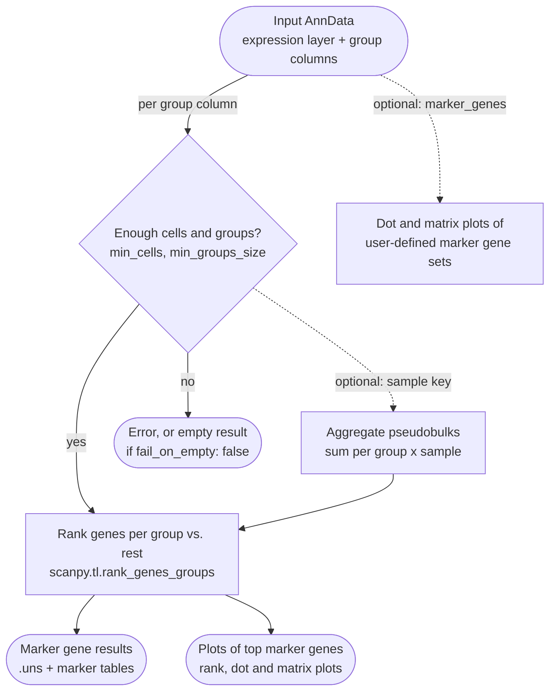

# Marker Genes

This module computes differentially expressed marker genes for one or more cell groupings (e.g. cell type or cluster columns in `.obs`) with `scanpy.tl.rank_genes_groups`, optionally on per-sample pseudobulks, and visualises both the computed markers and user-defined marker gene sets.



*Conceptual overview of the main steps of the module. See the [functional description](#functional-description) below for details.*

## Environments

- [`scanpy`](https://github.com/HCA-integration/scAtlasTb/blob/main/envs/scanpy.yaml): all rules

## Configuration

```yaml
DATASETS:
  test:
    input:
      marker_genes:
        test_1: test/input/pbmc68k.h5ad
    marker_genes:
      groups:              # .obs columns to compute markers for (one job per column)
        - bulk_labels
        - phase
      sample: louvain      # optional: aggregate pseudobulks per group x sample
      layer: X             # matrix to use, e.g. X or layers/counts
      marker_genes: default  # optional: comma-separated keys of MARKER_GENES
      rank_genes_groups:   # passed to scanpy.tl.rank_genes_groups
        reference: rest
        n_genes: 100
        method: wilcoxon
        min_groups_size: 2 # not passed to scanpy: min. samples per group (default: 10)
      plot:                # passed to the scanpy plotting functions
        n_genes: 20
        min_logfoldchange: 3
        n_groups_per_split: 5

MARKER_GENES:
  default:
    "T": [ "CD3D", "CD4", "CD8A" ]
    "B": [ "CD19", "CD79A" ]
```

A full example is in `workflow/marker_genes/test/config.yaml`.

### Parameters

- **`groups`**: `.obs` column(s) to group cells by. Each column is processed separately.
- **`sample`** (optional): `.obs` column with sample/donor IDs. If set, counts are summed into pseudobulks per group × sample before testing.
- **`layer`** (default: `X`): expression matrix to use for testing and user marker plots.
- **`rank_genes_groups`**: keyword arguments for [`scanpy.tl.rank_genes_groups`](https://scanpy.readthedocs.io/en/stable/api/generated/scanpy.tl.rank_genes_groups.html) (e.g. `method`, `reference`, `n_genes`). Special keys (not passed to scanpy):
  - `min_groups_size` (default: 10): minimum number of observations a group needs to be tested. When `sample` is set, observations are pseudobulks, so this is the minimum number of samples per group. Groups below it are not tested.
  - `min_cells` (default: 100): datasets with this many cells or fewer are not tested.
- **`fail_on_empty`** (default: `true`): if `min_cells` or `min_groups_size` filter out all cells, `rank_genes_groups` fails before loading the data, so that no further jobs are started. The error message says which filter removed everything and where to change it in the module configuration. Check the input data first; if it is correct, adjust the filters or set `fail_on_empty: false` to write an empty result instead. An input that is already empty (0 cells) never fails and always gives an empty result.
- **`plot`**: keyword arguments for the scanpy `rank_genes_groups` plotting functions. Special keys: `n_genes` (genes per group, default 10), `min_logfoldchange` (filter for plotted genes), `n_groups_per_split` (number of groups per dot/matrix plot).
- **`plot.group_order`** (optional): order in which groups are shown in the user marker gene plots. Can be a list, a comma-separated string, or a path to a text file with one group per line. Matching groups are plotted in the configured order (duplicates are ignored); any remaining observed groups are appended afterwards. See [Group ordering](#group-ordering) below.
- **`marker_genes`**: either a comma-separated string of keys into the top-level `MARKER_GENES` dictionary, or a dictionary of gene sets. Gene sets may be a list of genes, a dictionary `{label: [genes]}`, or a nested dictionary of such dictionaries.

### Group ordering

`group_order` belongs under `plot`. For a single group, use a flat list:

```yaml
plot:
  group_order:
    - B_cells
    - T_cells
```

For multiple groups with different orderings, use a dict keyed by group name:

```yaml
groups:
  - bulk_labels
  - phase
plot:
  group_order:
    bulk_labels:
      - B_cells
      - T_cells
      - Myeloid
    phase:
      - S
      - G1
      - G2M
```

## Functional description

### Inputs

* **File formats:** `.h5ad` or `.zarr` (AnnData), configured under `input: marker_genes:` (see [Architecture](https://scatlastb.readthedocs.io/en/latest/principles/architecture.html)).
* **Expression matrix:** the slot named by `layer` (default `X`; e.g. `layers/counts`). The matrix is used as stored — no normalisation is applied, so normalised data should be selected for cell-level tests, raw counts for pseudobulk tests.
* **`.obs`:** one grouping column per entry of `groups` (the parameter space is exploded so each column is its own `group` wildcard); optionally the `sample` column.
* **`.var`:** if a `feature_name` column exists it replaces `var_names` (gene symbols in outputs and for marker matching).
* **Marker gene sets:** resolved by `utils/marker_genes.py::get_marker_gene_set` from config `marker_genes` (string of comma-separated keys into top-level `MARKER_GENES`, or a dictionary).

### Processing steps

1. **`marker_genes_rank_genes_groups`** (script `scripts/rank_genes_groups.py`, environment `scanpy`). One job per file × `group` column.
   ```text
   read obs[[group, sample?]]
   # filters on metadata only, before loading any data
   if n_obs == 0: write empty output                          # input already empty
   if n_obs <= min_cells: fail, or write empty output if fail_on_empty is false
   count observations per group                               # cells, or group x sample pairs with ≥2 cells
   groups = groups with ≥ min_groups_size observations
   if no groups: fail, or write empty output if fail_on_empty is false
   use dask/backed reading if sample is set, or n_obs > 1e6, or n_unique(group[,sample]) > 1e5
   read X=<layer>, obs, var, uns
   if sample is set:
       pseudo_group = f"{group}_{sample}"
       adata = get_pseudobulks(adata, group_key=pseudo_group, agg="sum")   # pseudobulks with ≥2 cells
       rank_genes_groups.n_genes = n_vars                                  # report all genes
       recount groups on the pseudobulks
   scanpy.tl.rank_genes_groups(adata, groupby=<group>, groups=groups, pts=True,
                               use_raw=False, key_added=f"marker_genes_group={group}",
                               **rank_genes_groups)
   ```
   `min_groups_size` and `min_cells` are removed from `rank_genes_groups` before it is passed to scanpy (see [Parameters](#parameters)). The error raised when the filters remove all cells explains which filter did so and where to change it in the module configuration. Defaults of `scanpy.tl.rank_genes_groups` apply for unspecified arguments (e.g. `method='t-test'`, `reference='rest'`). The per-group output contains only the result in `.uns['marker_genes_group=<group>']`, or nothing if all cells were filtered out. A long-format table is derived from the result: per group, `gene`, `z-score`, `logfoldchange`, `pval`, `pval_adj`, `pct_within` (`pts`), `pct_outside` (`pts_rest`; for duplicated gene names the maximum is kept) and `-log10 pvalue`, indexed by `cluster`.

2. **`marker_genes_collect`** (script `scripts/collect.py`, environment `scanpy`). Adds the results of all groups to `.uns` of the input data: the result of each group replaces any previous result under the same key, and the key is removed for groups without a result. Results for groups that are not configured are kept. For `.zarr` input only `.uns` is written and all other slots are linked to the input; `.h5ad` input is written in full to `.zarr`.

3. **`marker_genes_plot`** (script `scripts/plot.py`, environment `scanpy`). Reads the result from the per-group output and `layer`, `.obs` and `.var` lazily from the input, extracts results with `scanpy.get.rank_genes_groups_df(log2fc_min=plot.min_logfoldchange)`, takes the top `plot.n_genes` (default 10) genes per group, subsets cells of tested groups and these genes into memory and computes PCA (`scanpy.pp.pca`). Groups are partitioned into `max(1, n_groups // n_groups_per_split)` splits (default `n_groups_per_split = 100 // n_genes`). Produces `scanpy.pl.rank_genes_groups` (rank plot; an empty figure is saved on error) and, per split, `rank_genes_groups_dotplot` and `rank_genes_groups_matrixplot` coloured by expression and by log fold change (`cmap='bwr'`, `vmin=-4`, `vmax=4`), with group totals added.

4. **`marker_genes_plot_user`** (script `scripts/plot_user.py`, environment `scanpy`). Runs independently of the marker gene computation. Reads `layer`, subsets to the union of user marker genes present in `var_names` and loads them densely. If `plot.group_order` is set, the categories of `<group>` are reordered: configured groups that are observed come first, in the configured order, followed by all remaining groups (see [Group ordering](#group-ordering)). A `group_order` file is declared as rule input, so that changes to it trigger a rerun. List-valued gene sets are combined into one set `markers`; each dictionary-valued superset becomes its own gene set. For each gene set, genes not found are dropped (empty labels removed, empty sets skipped), and `scanpy.pl.dotplot` (with totals) and `scanpy.pl.matrixplot` are drawn with `groupby=<group>`, `standard_scale='var'` and `use_raw=False`. Exits without plots if no genes match. `plot.n_groups_per_split` is accepted but not used for splitting here.

### Outputs

Relative to `<output_dir>/marker_genes/`:

* `dataset~<dataset>/file_id~<file_id>.zarr` — the input data with `.uns['marker_genes_group=<group>']` for all groups (scanpy `rank_genes_groups` structure: `names`, `scores`, `logfoldchanges`, `pvals`, `pvals_adj`, `pts`, `pts_rest`, `params`).
* `groups/dataset~<dataset>/file_id~<file_id>/group=<group>.zarr` — per-group result in `.uns` only (no `.uns` key if all cells were filtered out).
* `groups/dataset~<dataset>/file_id~<file_id>/group=<group>--marker_genes.tsv` — marker table (see step 1).

Relative to `<images>/marker_genes/dataset~<dataset>/file_id~<file_id>/group=<group>/`:

* `rank_plot.png`
* `dotplot/split=<i>_expression.png`, `dotplot/split=<i>_logfoldchanges.png`
* `matrixplot/split=<i>_expression.png`, `matrixplot/split=<i>_logfoldchanges.png`
* `user_markers/<gene_set>.png` (dot plot), `user_markers/<gene_set>_matrix.png` (matrix plot)
