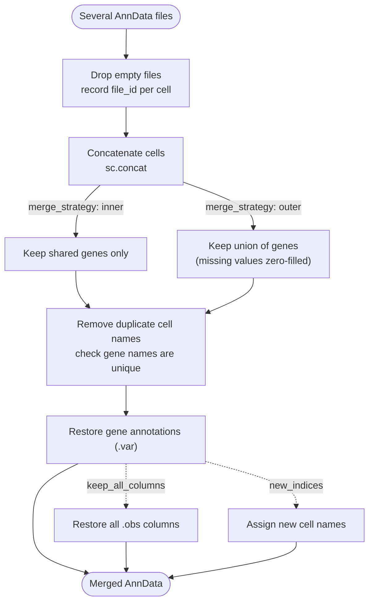

# Merge files

Merge multiple AnnData files into a single consolidated dataset by concatenating observations (cells) across files.
This module handles merging datasets with different gene sets, metadata schemas, and supports memory-efficient processing for large datasets.



*Conceptual overview of the main steps of the module. See the [functional description](#functional-description) below for details.*

## Configuration

```yaml
DATASETS:
  Lee2020:
    input:
      merge:
        file_1: test/input/load_data/harmonize_metadata/Lee2020.zarr
        file_2: test/input/load_data/harmonize_metadata/SchulteSchrepping2020.zarr
    merge:
      merge_strategy: inner
      keep_all_columns: true
      allow_duplicate_obs: true
      allow_duplicate_vars: false
      new_indices: false
      persist: true
      threads: 5
      stride: 500_000
      dask: true
      backed: true
      slots:
        X: X
        obs: obs
        var: var
        layers: layers
```

## Configuration Options

* **`merge_strategy`**: How to handle overlapping genes/variables across datasets
  - `"inner"`: Keep only genes present in all input datasets (intersection)
  - `"outer"`: Keep all genes from all datasets, filling missing values with zeros (union)

* **`keep_all_columns`**: How to handle observation metadata columns
  - `true`: Keep all obs columns from all datasets, filling missing values with NaN
  - `false`: Only keep obs columns retained by the concatenation, i.e. columns present in all datasets for `merge_strategy: inner` (all columns for `outer`)

* **`allow_duplicate_obs`**: How to handle duplicate observation names during merging
  - `true`: Allow duplicate cell barcodes/names in the final dataset
  - `false`: After merging, remove duplicate observations by keeping only the first occurrence of each duplicate name. **Note:** Duplicates between different input files will be silently dropped, which can result in data loss if files have overlapping cell names.

* **`allow_duplicate_vars`**: Whether duplicate variable names are allowed in the final merged dataset  
  - `true`: Allow duplicate gene names
  - `false`: Raise error if duplicate gene names are found

* **`new_indices`**: Whether to generate new sequential cell identifiers
  - `true`: Create new cell IDs in format `{dataset}-{index}` where dataset comes from wildcard and index is sequential (0, 1, 2, ...)
  - `false`: Preserve original cell names from input files (default)

* **`threads`**: Number of threads for parallel processing (used with Dask)

* **`stride`**: Cell batch size for processing large datasets
  - Controls how many cells are processed/merged in a single chunk.
  - In Dask mode with `persist: true`, this value is used as the batch size for each persisted merge step (up to `stride` cells per batch).
  - Smaller values reduce peak memory usage at the cost of more, smaller batches and higher scheduling overhead; larger values improve throughput but increase peak RAM usage.

* **`dask`**: Enable Dask arrays for distributed/out-of-core processing
  - `true`: Use Dask for memory-efficient processing of very large datasets
  - `false`: Use standard in-memory processing

* **`backed`**: Enable backed mode using AnnCollection for efficient merging
  - `true`: Keep data on disk during merging process
  - `false`: Load all data into memory

* **`persist`**: Persist intermediate Dask arrays during merge to keep task graphs shallow
  - `true`: In Dask mode with more than 2 inputs, merges files in cell-count batches of up to `stride` cells and persists each intermediate result.
  - `false`: Uses direct concatenation without intermediate persistence (default).
  - Persists materialize intermediate Dask arrays into worker memory; this can significantly increase peak RAM usage compared to non-persisted execution, especially for large `stride` values or very large datasets.
  - Recommended for performance when enough memory is available; consider disabling or reducing `stride` on memory-constrained systems.
  - Only relevant when `dask: true`

* **`slots`**: Specify which data slots to read from zarr files
  - Dictionary mapping slot names to zarr group names
  - Only applies to zarr input files

## Processing Modes

### Standard Mode (default)
- Loads files sequentially into memory
- Uses `scanpy.concat()` for merging
- Best performance for datasets that fit in memory

### Dask Mode (`dask: true`)
- Uses Dask arrays for out-of-core processing
- Memory-efficient for very large datasets
- Supports parallel processing across chunks
- With `persist: true` and more than 2 input files, intermediate merges are persisted to reduce graph depth and scheduler overhead

### Backed Mode (`backed: true`)
- Uses AnnCollection to keep data on disk
- Good balance between memory efficiency and performance
- Suitable for moderately large datasets

## Behavior

### File Processing
1. **Single File**: Creates symbolic link instead of merging if only one input file
2. **Multiple Files**: Concatenates all files along the observation (cell) axis
3. **Gene Alignment**: Aligns gene sets according to `merge_strategy`
4. **Metadata Merging**: Combines observation metadata according to `keep_all_columns`

### Index and Metadata Handling
- **Cell Identifiers**: 
  - When `new_indices: true`, generates new cell IDs in format `{dataset}-{sequential_index}` where `dataset` is from the wildcard and `sequential_index` is a running index (0, 1, 2, ...). Original cell names are preserved in `obs_names_before_{dataset}` column
  - When `new_indices: false`, preserves original cell IDs from input files
- **Dataset Tracking**: Adds `file_id` column to obs and stores dataset info in `uns['merge']`
- **Duplicate Checking**: 
  - If `allow_duplicate_obs=False`, duplicate observations are automatically removed (keeping first occurrence)
  - If `allow_duplicate_vars=False`, duplicate variables cause an error and merging is halted

### Memory Optimization
- Automatic garbage collection between files
- Slot removal to free memory during processing
- Sparse matrix format preservation
- Chunked processing for large datasets
- Optional intermediate persistence for Dask merges (`persist: true`)

## Use Cases

- **Multi-sample studies**: Combine data from different experimental conditions
- **Cross-dataset integration**: Merge datasets from different studies or technologies
- **Batch processing**: Consolidate results from parallel processing pipelines
- **Data warehousing**: Create unified datasets for downstream analysis

## Functional description

### Inputs

* **File formats:** any number of `.h5ad` or `.zarr` AnnData files per task, configured under `input: merge:` (see [architecture](https://scatlastb.readthedocs.io/en/latest/principles/architecture.html)). All input files of one task are merged into one output; the file ids of the inputs become the values of `.obs['file_id']`.
* **Slots:** by default all slots are read (`utils/io.py::read_anndata`). `slots` (default `{}`) maps AnnData slot names to zarr group names, e.g. `{X: layers/counts}`, and restricts/renames what is read. `slots['X']` (default `X`) is also used to look up the shape of each zarr input.
* **Config keys** (see Configuration above) with defaults as implemented in the Snakefile: `merge_strategy='inner'`, `keep_all_columns=false`, `dask=false`, `backed=false`, `persist=false`, `stride=100000`, `threads=1`, `allow_duplicate_obs=false`, `allow_duplicate_vars=false`, `new_indices=false`. The rule requests 3× the default `cpu` memory profile.

### Processing steps

1. **`merge_merge`** (script `merge.py`, environment `scanpy`). One job per task (wildcard `dataset`). Dask is configured with `num_workers = threads` and `array.slicing.split_large_chunks=False`.
   ```text
   if one input file: symlink it to the output (link_zarr) and stop
   shape[file] = n_obs/n_vars from <zarr>/<slots.X>/.zattrs (fallback: read obs+var)
   drop files with n_obs == 0; if none left: write an empty AnnData and stop
   for each file: adata_i = read_anndata(file, **slots); obs['file_id'] = file_id; ensure sparse X/layers
   if dask:                       # all files read with backed=True, dask=True, chunk stride=stride
       if persist and n_files > 2:
           group consecutive files into batches of >= stride cells
           concat each batch (sc.concat(join=merge_strategy)), .persist() X/raw/layers
           reduce batches pairwise ((0,1),(2,3),…, odd one carried) with concat + persist until one is left
       else:
           sc.concat(all, join=merge_strategy); persist once if persist
   elif backed:                   # slots mapping is not applied in this mode
       AnnCollection(adatas, join_obs='outer', join_obsm=None, join_vars=merge_strategy)[:].to_adata()
   else:                          # in memory
       adata = adata_1; for i >= 2: adata = sc.concat([adata, adata_i], join=merge_strategy)
   if not allow_duplicate_obs: drop cells whose obs_name occurred before (keep first)
   if not allow_duplicate_vars: assert var_names are unique
   for each input var table: copy its columns into merged .var for the shared genes
       (categoricals cast to str), then infer dtypes
   if keep_all_columns:
       outer-concat .obs of all inputs (dropping duplicate indices unless allowed),
       align to merged obs_names (error if cells are missing), obs = obs.combine_first(merged_obs)
   uns['merge'] = {files, file_ids, n_files, merge_strategy, allow_duplicate_obs,
                   allow_duplicate_vars, reindexed=new_indices, original_shapes}
   if new_indices: obs['obs_names_before_<dataset>'] = obs_names
                   obs_names = '<dataset>-' + 0..n_obs-1
   write_zarr (dask arrays are computed while writing)
   ```
   `join=merge_strategy` controls both the gene set (`inner`: intersection, `outer`: union with zero fill) and, because `sc.concat` is called without a `merge` argument, the `.obs` columns kept by default (`inner`: shared columns only, `outer`: all columns). `.var` annotation and, with `keep_all_columns`, `.obs` columns lost by the concatenation are restored afterwards. Slots that differ between files are handled by `anndata.concat` semantics (e.g. `.obsm` keys missing in one file are dropped for `inner`). `.uns` of the inputs is not carried over.

### Outputs

Relative to `<output_dir>/merge/`:

* `dataset~<dataset>.zarr` — merged AnnData with
  * `.obs['file_id']` — input file id of every cell,
  * `.obs['obs_names_before_<dataset>']` — only with `new_indices: true`,
  * `.var` — union of the per-file gene annotations for the retained genes,
  * `.uns['merge']` — provenance dictionary described above.

  Data types and sparse formats are preserved where possible. With a single input file the output is a symlink to the input and none of the above annotations are added.

### Environments

* [`scanpy`](https://github.com/HCA-integration/scAtlasTb/blob/main/envs/scanpy.yaml)
