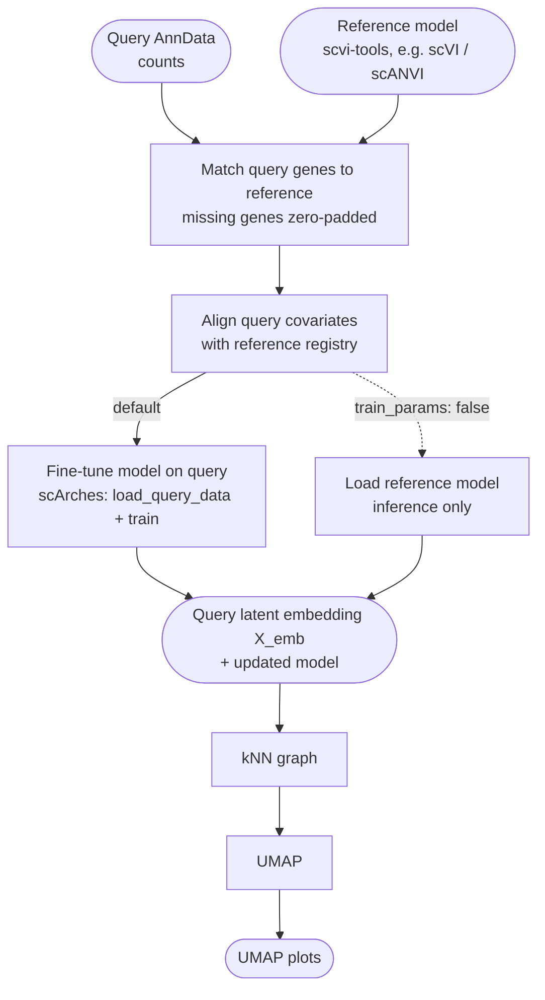

# Reference mapping

This module enables projection of new single-cell RNA-seq datasets onto pre-trained variational autoencoder (VAE) models or foundation models. This allows for:

- Transfer learning from large reference datasets to smaller query datasets
- Integration of new data with existing atlases
- Consistent cell type annotation across studies
- Leveraging pre-trained embeddings for downstream analysis



*Conceptual overview of the main steps of the module. See the [functional description](#functional-description) below for details.*

## Supported Models

The module currently supports:
- **scvi-tools models**: Various variational inference models (scVI, scANVI, etc.) mapping with scArches
- TODO: **scArches models**: VAE-based models (trVAE, scPoli, Expimap, etc.)
- TODO: **Foundation models**: Large-scale pre-trained models

## Configuration

```yaml
DATASETS:
  test:
    input:
      reference_mapping:
        query: test/input/pbmc68k.h5ad

    reference_mapping:
      scarches:
        layer: layers/counts  # or X
        var_key: feature_name  # optional
        model: test/input/model
        model_params:
          batch_key: sample_id
          labels_key: cell_type
          categorical_covariate_keys: [donor, condition]
          continuous_covariate_keys: [age]
        train_params:  # set to false for inference only (no query training)
          max_epochs: 10
          early_stopping: true
          check_val_every_n_epoch: 1
      neighbors:  # optional, passed to the kNN graph computation
        n_neighbors: 30
      umap_colors:  # optional, .obs columns to color the UMAP by
        - cell_type
```

### Configuration Parameters

- **`layer`** (default: `'X'`): Which slot of the query AnnData object to use as input counts, given as a path in the file
  - `'X'` uses the main expression matrix (`.X`)
  - `'layers/counts'` uses the counts layer from `.layers['counts']` (the `layers/` prefix is required)
  - `'raw/X'` uses `.raw.X`

- **`var_key`** (default: `None`): Column name in `.var` to use for gene matching between query and reference model
  - If `None`, uses the `.var` index (var_names)
  - Important for ensuring gene names are consistent between query and reference model

#### Model Parameters (`model_params`)
Parameters that align the query data structure with the reference model's expectations:

- **`batch_key`**: Column name in `.obs` containing batch/sample information (required)
- **`labels_key`**: Column name in `.obs` containing cell type labels (optional, can be `None` for unlabeled data)
- **`size_factor_key`**: Column name in `.obs` containing size factors (optional, only if the reference model uses one)
- **`categorical_covariate_keys`**: List of categorical covariate column names in `.obs` (optional, e.g., `["donor", "condition"]`)
- **`continuous_covariate_keys`**: List of continuous covariate column names in `.obs` (optional, e.g., `["age", "BMI"]`)
- Any remaining keys are passed to `load_query_data` of the model class.

#### Training Parameters (`train_params`)
Parameters that control the reference mapping training process (all optional). They are passed to the model's `train()` method on top of the defaults below.
Set `train_params: false` to skip training and only compute the latent representation of the query with the unchanged reference model.

- **`max_epochs`**: Maximum number of training epochs (default: 10)
- **`check_val_every_n_epoch`**: How often to run validation during training (default: 1, needed for loss curves)
- **`plan_kwargs`**: Training plan arguments (default: `{weight_decay: 0.0}`)
- Any other argument accepted by the model's `train()` method, e.g. **`early_stopping`**

> **Note:** The query data must have genes that overlap with the reference model's training data. Gene matching is performed using the `var_key` parameter or `.var` index. Only overlapping genes are used for mapping and missing genes from the query are padded with zeros.

## Functional description

### Inputs

- **Query AnnData** (`input: reference_mapping: {file_id: path}`), `.zarr` or `.h5ad`. The script reads:
  - the count matrix from the slot given by `scarches.layer` (default `X`; any file path such as `layers/counts` or `raw/X`), loaded lazily with dask and computed after subsetting genes,
  - `.obs` (columns named in `scarches.model_params`) and `.var` (index, or the column `scarches.var_key` for gene matching).
- **Reference model directory** (`scarches.model`, required): a saved scvi-tools model directory containing `model.pt`. The checkpoint must contain `var_names`. The model class is read from the saved registry (`registry["model_name"]`) and looked up in `scvi.model`, `scvi.external` and, if installed, `drvi.model`.
- Optional dataset-level keys `reference_mapping.neighbors` (kNN arguments) and `reference_mapping.umap_colors` (plot colors). See Configuration above.

### Processing steps

1. **`reference_mapping_scarches`** (script `scripts/scarches.py`, environment `scvi-tools`, GPU profile). Uses the scArches query-to-reference approach as implemented in scvi-tools; the registry alignment helpers in `scripts/openpipelines_functions.py` are adapted from openpipelines.

   ```text
   train_params := false            -> inference_only
                 | {max_epochs: 10, plan_kwargs: {weight_decay: 0.0},
                    check_val_every_n_epoch: 1} | train_params
   pop batch_key (required), labels_key, size_factor_key,
       categorical_covariate_keys, continuous_covariate_keys from model_params
   model_torch := torch.load(model/model.pt)       # on GPU if available
   adata := read query (X=layer, obs, var)
   genes := var_names or var[var_key]
   adata := adata[:, genes ∈ model_torch.var_names]  # assert > 0 overlapping genes
   missing := model genes absent from query -> append all-zero sparse columns
   Model := class named in registry (scvi.model / scvi.external / drvi.model)
   adata := _align_query_with_registry(adata, ...)
   Model.prepare_query_anndata(adata, model)       # reorders/pads genes; on ValueError, raise with both gene lists
   if inference_only:
       vae := Model.load(model, adata)
   else:
       obs[batch_key] := "query_" + obs[batch_key]   # if column present: forces new batch categories
       vae := Model.load_query_data(adata, model, **remaining model_params)
              # KeyError (old models without setup_method_name): patch registry to
              # "setup_anndata", save to a temp dir and retry
       vae.train(**train_params); plot loss curves (integration plot_model_history)
   X_emb := vae.get_latent_representation(adata)
   ```

   `_align_query_with_registry` validates the given keys against the reference registry: a key that the model was set up with must be given (except `labels_key` if the model has an `unlabeled_category`); keys given but unused by the model only produce a warning; the number of categorical/continuous covariates must match the model. It then rebuilds `.obs` so that it contains only the columns the model expects, renamed to the reference names (batch, size factor, labels, covariates). If the model uses labels but no `labels_key` is given, all query cells are set to the model's `unlabeled_category`. `.var` is reduced to the index.

   For `.h5ad` input the original file is re-read (after checking the cell names match) so that the output keeps all original slots. `X_emb` is stored in `.obsm` and the updated query model is saved with `vae.save(..., overwrite=True)`.

2. **`reference_mapping_neighbors`** (preprocessing `scripts/neighbors.py`, environment `scanpy` or `rapids_singlecell` on GPU). Reused from the preprocessing module. `sc.pp.neighbors(use_rep='X_emb', **reference_mapping.neighbors)` with `n_neighbors` defaulting to 15 (capped at the number of cells); `uns['output_type'] = 'embed'` is added. Retried up to 2 times.
3. **`reference_mapping_compute_umap`** (preprocessing `scripts/umap.py`, environment `scanpy` or `rapids_singlecell`). `sc.tl.umap(init_pos='random')` on the kNN graph. From the second attempt on it falls back to CPU resources.
4. **`reference_mapping_plot_umap`** (preprocessing `scripts/plot.py`, environment `scanpy`). `sc.pl.embedding(basis='X_umap')` for every column in `umap_colors` that exists in `.obs` and has more than one value. Categories with ≤ 0.01 % of cells are hidden (`min_cells_per_category=0.0001`). Colors that are not `.obs` columns are treated as gene names.

### Outputs

Paths follow the wildcard pattern `<pattern>` = `dataset~<dataset>/file_id~<file_id>` (see [architecture](https://scatlastb.readthedocs.io/en/latest/principles/architecture.html)).

| Path | Content |
|---|---|
| `<output_dir>/reference_mapping/model/<pattern>.zarr` | query with `obsm['X_emb']` (only `obsm` is written; all other slots are linked to the input) |
| `<output_dir>/reference_mapping/model/<pattern>/` | updated scvi-tools model (`model.pt`) for further mapping |
| `<output_dir>/reference_mapping/postprocess/<pattern>.zarr` | + `obsp['connectivities']`, `obsp['distances']`, `uns['neighbors']`, `uns['output_type']` |
| `<output_dir>/reference_mapping/<pattern>.zarr` | final mapped object: latent embedding `obsm['X_emb']` in the reference space, kNN graph on `X_emb`, + `obsm['X_umap']` |
| `<images>/reference_mapping/model/<pattern>/` | training loss curves (empty for inference only) |
| `<images>/reference_mapping/umap/<pattern>/` | UMAP plots, one `.png` per color in `umap_colors` |

### Environments

- [`scvi-tools`](https://github.com/HCA-integration/scAtlasTb/blob/main/envs/scvi-tools.yaml): mapping with scArches (`scarches` rule). Uses the GPU resource profile, and the GPU if CUDA is available.
- [`scanpy`](https://github.com/HCA-integration/scAtlasTb/blob/main/envs/scanpy.yaml): neighbors, UMAP and plots (reused from the preprocessing module). [`rapids_singlecell`](https://github.com/HCA-integration/scAtlasTb/blob/main/envs/rapids_singlecell.yaml) replaces `scanpy` for neighbors and UMAP when `use_gpu: true`.
