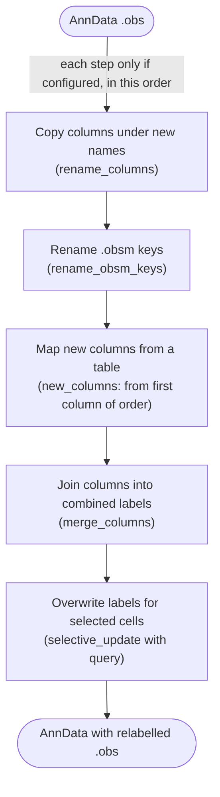

# Relabel

This module is used to relabel and merge columns in an AnnData object based on a configuration file.
It is useful for reproducibly ingesting or mapping obs-level metadata based on existing columns or the index of `.obs`.



*Conceptual overview of the main steps of the module. See the [functional description](#functional-description) below for details.*

## Config file

**TL;DR:** Here is an example config showcasing some possible options of the `relabel` module.

```yaml
DATASETS:
  
  dataset_name:  # can replace with a representative name
    
    input:
      # input file mapping for relabel module
      relabel:
        file_1: test/input/pbmc68k.h5ad
        file_2: test/input/pbmc68k.h5ad
    
    # module configuration
    relabel:
      
      # mapping setup for adding new columns
      new_columns:
        file:  test/input/mapping.tsv
        order:
          - cell_type
          - harmonized_label
          - lineage
      
      # mapping setup for merging existing columns
      merge_columns:
        file:  test/input/merge_test.tsv
        sep: '-'
      
      # mapping setup for selective update of existing columns
      selective_update: # 
        base_column: bulk_labels
        new_column: bulk_labels_new
        update_map:
          louvain:
            '6': Dendritic
            '8': 'CD19+ B'

      # rename existing obsm keys
      rename_obsm_keys:
        X_pca: X_emb
```

## Mapping modes

This module supports different modes of mapping metadata to the AnnData object.
You decide on any number of mapping modes in a single setup to map different metadata columns in a single run.
In the following, the different mapping modes are explained.

### Mapping new columns: `new_columns`

Adding new columns to the AnnData object requires a mapping file that specifies how to map existing columns to new ones.
In the configuration, you need to specify a TSV file with the mapping as well as the order of the columns to be matched.

```yaml
...
      new_columns:
        file:  test/input/mapping.tsv  # mapping file
        order:
          - cell_type  # first entry MUST be an existing column in the anndata object
          - harmonized_label  # metadata that hierarchically to first entry ('cell_type')
          - lineage  # metadata that hierarchically to first entry ('cell_type')
```

* `file`: the path to the mapping file in a tabular format.
* `order`: a list of columns in the mapping file that should be matched to the existing columns in the AnnData object.
  The first entry must be an existing column in the AnnData object, and the subsequent entries are the new columns to be created based on the mapping.

The new column mapping file must be in TSV format with at least one column in the anndata object.
The columns must include at least all columns that are specified in the `order` list.

Example for `test/input/mapping.tsv`:

```
bulk_labels	lineage
CD14+ Monocyte	myeloid
Dendritic	lymphoid
CD56+ NK	lymphoid
CD4+/CD25 T Reg	lymphoid
```

Alternatively, you can map values via index (`.obs_names`) of the AnnData object.
In that case, the first entry of the `order` list must be the name of the index column in the mapping file.

```yaml
...
      new_columns:
        index_col: index # column in the mapping file that should be used as index
        file: test/input/mapping_index_test.tsv # mapping file with metadata mapped to index
        order:
          - index # first entry MUST be the index column in the mapping file
          - relabel_by_index
```

* `index_col`: the name of the index column in the mapping file that should be used as index.
  If not specified, index mode is not used, so `index_col` must be set explicitly when mapping by index.

Note, that if the index in the mapping file does not match the index in your AnnData object, the pipeline will raise an error.

#### Mapping file format

The file format needs to be tabular and can be either one of TSV, CSV, or Parquet.
Parquet files are fully [compatible with Pandas](https://pandas.pydata.org/pandas-docs/stable/user_guide/10min.html#parquet) and are more computationally efficient than text-based files, both in storage and processing speed.

```yaml
...
      new_columns:
        index_col: index
        file: test/input/mapping_index_test.parquet # use parquet file for mapping
        order:
          - index
          - relabel_by_index
```


### Merge existing columns: `merge_columns`

The values of existing columns can be merged into a new column.
This is most useful when you want more granular categories in a single column, e.g. when a batch consists of a sample + pool.

```yaml
...
      merge_columns:  # mapping setup for merging existing columns
        file:  test/input/merge_test.tsv  # TSV file with cell label mapping
        sep: '-'  # separator for merging columns
      
```

* `file`: the path to the mapping file in a TSV format.
* `sep`: the separator used to merge the column values. The default is `'-'`, but you can specify any separator you like.

The merge column mapping file (`file`) must be in TSV format with the following columns:

* `file_id`: input file id that is used in the pipeline to match which file to add the new column to
* `column_name`: new column name
* `columns`: columns to merge, separated by `,` (no whitespaces)

Example for `test/input/merge_test.tsv`:

```
file_id	column_name	columns
file_1	cc_joint	S_score,G2M_score
file_1	ct_joint	bulk_labels,louvain
file_2	counts_joint	n_genes,n_counts
```

### Selective update of an existing column: `selective_update`

The selective update allows you to create a new column based on an existing column and a mapping of values.

```yaml
...
      selective_update:
        base_column: bulk_labels # column for which values should be updated
        new_column: bulk_labels_new # new column to be created
        query: 'n_counts > 1000' # optional pandas query to restrict update to specific cells
        update_map: # mapping of values to be updated based on column
          bulk_labels: # column to condition which cells get remapped
            'Dendritic':  # empty value means np.nan
            'CD19+ B': 'nan' # can map to specific values including 'nan'
          louvain:
            '6': Dendritic # reannotate cells where 'louvain == "6"' to "Dendritic"
            '8': 'CD19+ B'
          
```

* `base_column`: the starting column of which the values should be modified
* `new_column`: the name of the new column to be created. If it is not defined, it will be the same as `base_column`.
* `query`: optional pandas query string to restrict the update to specific cells. The query is combined with column-specific queries using AND logic: `(user_query) & (column.isin(mapped_values))`. Defaults to `'True'` if not specified.
* `update_map`: a mapping of values that should be updated. The keys are the columns in the AnnData object, and the values are dictionaries with the values to be updated. Alternatively, the values can be a file path to a TSV file with the mapping. An empty value (no value after `:`) means the mapped cells will be set to `np.nan`.

The selective update works by:
1. Starting with a copy of `base_column` as `new_column`
2. For each column in `update_map`, creating a query that combines the user `query` with `column.isin(mapped_keys)`
3. Only updating cells that match both the user query AND have values that are keys in the mapping dictionary
4. Applying the mapped values to matching cells

Below is an example where one update entry is defined by a TSV file instead of a dictionary:

```yaml
...
      selective_update:
        base_column: bulk_labels
        new_column: lineage
        update_map:
          lineage: test/input/mapping_test.tsv # mapping defined in a TSV file
          louvain:
            '6': myeloid
            '8': lymphoid
```

When using a mapping TSV file for `update_map`, the file must contain the `base_column` (in this example `bulk_labels`) as well as the `update_map` key column (in this example `lineage`).
The following example `test/input/mapping_test.tsv` shows a valid TSV definition of the `update_map` key `lineage`: 

```
bulk_labels	lineage
CD14+ Monocyte	myeloid
Dendritic	myeloid
CD56+ NK	lymphoid
CD4+/CD25 T Reg	lymphoid
CD19+ B	lymphoid
CD8+ Cytotoxic T	lymphoid
CD4+/CD45RO+ Memory	lymphoid
CD8+/CD45RA+ Naive Cytotoxic	lymphoid
CD4+/CD45RA+/CD25- Naive T	lymphoid
CD34+	HSCs
```

### Rename existing obsm keys: `rename_obsm_keys`

You can rename existing obsm keys in the AnnData object by specifying a mapping of old to new keys.

```yaml
...
      rename_obsm_keys:
        X_pca: X_emb  # rename 'X_pca' to 'X_emb'
```

This will rename the obsm key `X_pca` to `X_emb` in the AnnData object, without modifying any data.

## Other parameters

* `dask`: Whether to use Dask for dask-support when reading and writing files, only applies to inputs that are `h5ad`, because the complete input needs to be written to a new `zarr` store. Default is `True`.
* `threads`: Number of threads to use for reading and writing files. Default is `1`.

## Functional description

### Inputs

* **File formats:** `.h5ad` or `.zarr`, configured under `input: relabel:` (see [architecture](https://scatlastb.readthedocs.io/en/latest/principles/architecture.html)). For `.zarr` input only `.obs` (and `.obsm` if `rename_obsm_keys` is set) is read; for `.h5ad` the whole file is opened lazily (`dask=True, backed=True`).
* **Mapping files** (added as rule inputs): `new_columns.file` (`.tsv`, `.csv` or `.parquet`), `merge_columns.file` (TSV) and any string values of `selective_update.update_map` (TSV).
* **Config keys** (see [Config file](#config-file)): `rename_columns` (`{}`), `rename_obsm_keys`, `new_columns` (`file`, `order`, optional `index_col`), `merge_columns` (`file`, `sep`, default `'-'`), `selective_update` (`base_column`, `new_column` = `base_column`, `update_map`, `query` = `'True'`), `dask` (`true`), `threads` (`1`, Dask workers). The Snakefile asserts that `new_columns` has `file` and `order` and `merge_columns` has `file` when given as dictionaries.

### Processing steps

1. **`relabel_relabel`** (script `script.py`, environment `scanpy`). One job per task × input file. The operations are applied in this fixed order:
   1. **`rename_columns`** — for each `old: new`: `obs[new] = obs[old]` (the old column is kept). If `old` does not exist, `obs[old]` is created with the string `'nan'` (and `new` is not created).
   2. **`rename_obsm_keys`** — `obsm[new] = obsm[old]`, then `del obsm[old]`; missing keys are skipped with a warning.
   3. **`new_columns`** — hierarchical mapping from a table:
      ```text
      if index_col is set: obs index (or obs[index_col] if it is a column) becomes index named index_col
      table = read(file, usecols=order, dtype=str, comment='#', NA strings -> NaN)
              # csv/tsv via dask.dataframe (rows pre-filtered to obs_names in index mode), parquet via pandas
      if index_col in table: table = table.set_index(index_col).reindex(obs_names)
                     error if no row matches
      cast each column to boolean ('true'/'false') or numeric where possible
      source = order[0]          # must be an obs column (or index_col)
      for target in order[1:]:
          if source == index_col: obs[target] = table[target]      # index mode
          else: pairs = unique (source, target) rows, whitespace-stripped
                obs[target] = obs[source].map(dict(pairs)) as category   # last pair wins
                log number of unmapped cells (NaN)
      restore original obs index
      ```
      Every target column is mapped from the first entry of `order`, not from the preceding entry.
   4. **`merge_columns`** — read the TSV, keep rows whose `file_id` equals the last `:`-separated part of the file id wildcard (warning if none), require columns `file_id`, `column_name`, `columns` and no duplicate rows; for each row: `obs[column_name] = sep.join(str(obs[c]) for c in columns.split(','))` per cell.
   5. **`selective_update`**:
      ```text
      obs[new_column] = obs[base_column].astype(str)
      for col, mapping in update_map:
          if mapping is a file: mapping = unique (col -> base_column) pairs from the TSV
          mask = obs.eval(f'({query}) & ({col}.isin(mapping keys))')
          obs.loc[mask, new_column] = obs[col].map(mapping)[mask]    # empty value -> NaN
      ```
      Later entries of `update_map` overwrite earlier ones for cells matched by both.

   Finally `.obs` (and `.obsm` if renamed) are written; all other slots are symlinked to the input (`write_zarr_linked`, `compute = not dask`). For `.h5ad` input a full zarr copy is written.

### Outputs

Relative to `<output_dir>/relabel/`:

* `dataset~<dataset>/file_id~<file_id>.zarr` — input AnnData with modified/added `.obs` columns (renamed copies, mapped categorical columns from `new_columns.order[1:]`, merged string columns, the selectively updated column) and, if configured, renamed `.obsm` keys.

### Environments

* [`scanpy`](https://github.com/HCA-integration/scAtlasTb/blob/main/envs/scanpy.yaml)

## Testing

Activate the snakemake environment and call `test/run_test.sh` with run specific Snakemake parameters.

```
conda activate snakemake
bash test/run_test.sh -n  # dry run
bash test/run_test.sh -c2  # actual run with max 2 cores
```
