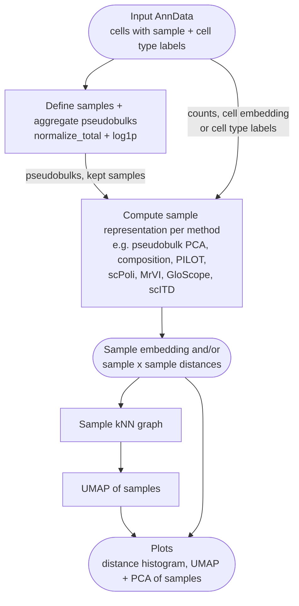

# Sample representation

This module computes sample-level representations from single-cell data, e.g. pseudobulk expression, cell type composition or learned sample embeddings.
Each method returns one representation (embedding and/or sample-by-sample distance matrix) per sample, which is then used to build a sample kNN graph, UMAP and plots.
Most methods are run through [patpy](https://github.com/lueckenlab/patpy).



*Conceptual overview of the main steps of the module. See the [functional description](#functional-description) below for details.*

## Configuration

```yaml
DATASETS:
  test:
    input:
      sample_representation:
        pbmc: test/input/pbmc68k.h5ad
    sample_representation:
      sample_key: bulk_labels  # .obs column(s) defining samples, comma-separated for composite keys
      cell_type_key: batch  # .obs column with cell type labels
      raw_counts: layers/counts  # counts slot used by feature-based methods
      norm_counts: layers/normcounts  # normalized slot used for pseudobulk aggregation in the prepare step
      aggregate: sum  # aggregation function for pseudobulks: sum or mean
      use_rep:  # embeddings used by embedding-based methods
        - obsm/X_pca
      var_mask: highly_variable  # .var column used to subset genes for count-based input
      min_cells_per_sample: 50
      min_cells_per_cell_type: 10
      colors:  # .obs columns to color the sample UMAP and PCA plots by
        - bulk_labels
      dask: false  # read data lazily with dask in the prepare step
      methods:  # each method with optional hyperparameters
        pseudobulk:
        composition:
        cell_type_pseudobulk:
        pilot:
        scpoli:
          n_epochs: 100
        mrvi:
          max_epochs: 100
        gloscope:
        scitd:
```

### Parameters

- **`methods`** (required): methods to run, as keys with optional hyperparameters. Available methods are listed in `params.tsv`: `pseudobulk`, `composition`, `cell_type_pseudobulk`, `pilot`, `scpoli`, `mrvi`, `gloscope`, `scitd`.
- **`sample_key`**: `.obs` column(s) that define a sample. Multiple columns can be given comma-separated and are concatenated. If not set, every cell is treated as its own sample.
- **`cell_type_key`**: `.obs` column with cell type labels, required by `composition`, `cell_type_pseudobulk`, `pilot`, `scpoli`, `mrvi` and `scitd`.
- **`use_rep`**: one or more embeddings (e.g. `obsm/X_pca`) for methods that accept an embedding as input (`pseudobulk`, `cell_type_pseudobulk`, `pilot`, `gloscope`). Embedding-based runs are skipped if `use_rep` is not set.
- **`raw_counts`** (default: `X`): slot with the counts used by feature-based methods.
- **`norm_counts`** (default: `X`): slot that is aggregated into pseudobulks in the preparation step.
- **`var_mask`**: boolean `.var` column used to subset genes. Only applies to count-based input (`X`, `layers/...`, `raw/...`).
- **`aggregate`** (default: `sum`): pseudobulk aggregation, `sum` or `mean`.
- **`min_cells_per_sample`**, **`min_cells_per_cell_type`**: minimum number of cells. Currently passed to the preparation step but not applied by the code; only samples with fewer than 2 cells are removed.
- **`colors`**: `.obs` columns used to color the sample-level plots.
- **`dask`**: whether to read the input lazily with dask in the preparation step.

## Functional description

### Inputs

- Input AnnData (`input: sample_representation: {file_id: path}`) in `.zarr` or `.h5ad` format.
- `.obs`: the columns in `sample_key` (comma-separated list, default: none) and `cell_type_key`.
- Count matrices: `norm_counts` (default `X`) is aggregated into pseudobulks in the `prepare` step. `raw_counts` (default `X`) is the input of all methods with `input_type: feature`.
- Embeddings: each entry in `use_rep` (e.g. `obsm/X_pca`, default: none) is the input of methods with `input_type: embed`.
- `.var[var_mask]` (boolean column, default: none) subsets genes when the input is a count matrix (`X`, `layers/...`, `raw/...`).

### Parameter space

`SampleRepresentationConfig` (subclass of the integration module's `IntegrationConfig`) builds one job per dataset × file_id × method × hyperparameter set × `use_rep` × `var_mask`, from `params.tsv`:

```text
explode params.tsv input_type ("embed,feature" -> two rows)
for each row:
    use_rep := raw_counts   if input_type == feature
               use_rep      if input_type == embed
               'None'       otherwise (composition)
drop rows with input_type == embed and use_rep == 'None'
var_mask := var_mask if use_rep is X, layers/* or raw/* else 'None'
drop duplicates
```

Hyperparameters under `methods: <method>:` are serialized into the `hyperparams` wildcard (as in the integration module). The script is `scripts/methods/<method>.<script_suffix>`, and the conda environment and resource profile (`cpu`/`gpu`) come from `params.tsv`. See [architecture](https://scatlastb.readthedocs.io/en/latest/principles/architecture.html) for wildcard and file naming.

### Processing steps

1. **`sample_representation_prepare`** (script `scripts/prepare.py`, environment `scanpy`). Runs once per dataset and file_id.

   ```text
   adata := read(X=norm_counts, obs, var; dask if `dask`)
   if sample_key is empty/None:
       obs['group'] := obs_names                  # one "sample" per cell
       bulks := adata
   else:
       assert all sample_key columns in obs
       obs['group'] := '-'.join(obs[sample_key] as str)
       bulks := get_pseudobulks(adata, group_key='group', agg=aggregate)
                # groups with < 2 cells are dropped; obs aggregated per group
   sc.pp.normalize_total(bulks); sc.pp.log1p(bulks)
   write bulks.zarr; write prepare.zarr (only obs updated, other slots linked)
   ```

   `min_cells_per_sample` and `min_cells_per_cell_type` are passed to this rule but are not used by the script. The samples kept in `bulks.zarr` define which samples appear in every method output: each method subsets its result to `bulks.obs_names`.

2. **`sample_representation_run_method`** (script `scripts/methods/<method>.{py,R}`, environment from `params.tsv`). Reads `prepare.zarr` (the `use_rep` slot, `.obs` with `group`) and `bulks.zarr`. For count input, genes are subset to `var[var_mask]`. Inputs with more than 1e6 cells (2e6 for `cell_type_pseudobulk`) are read lazily with dask. Each method creates a new AnnData with one observation per sample (`group`) and computes a sample kNN graph.

   | Method | What it does | Input | Output | Env |
   |---|---|---|---|---|
   | `pseudobulk` | Count input: `sc.pp.pca` on the normalized, log-transformed pseudobulks from `prepare` (after `var_mask`), `X_emb = X_pca`. Embedding input: mean of `use_rep` per sample, then `sc.pp.pca`. kNN with `sc.pp.neighbors(use_rep='X_emb')` | feature (pseudobulks from `norm_counts`), embed | embedding | `sample_representation` |
   | `composition` | Cell type proportions per sample, `patpy.tl.CellGroupComposition(cell_group_key=cell_type_key)`, Euclidean distances | `.obs` only | distances | `sample_representation` |
   | `cell_type_pseudobulk` | Mean expression per sample and cell type (`patpy.tl.GroupedPseudobulk`, `aggregate='mean'`, Euclidean distances). `X_emb` = horizontally stacked per-cell-type profiles, one `.obsm` entry per cell type | feature, embed | embedding + distances | `sample_representation` |
   | `pilot` | Optimal-transport distances between cell-state distributions (PILOT, via `patpy.tl.PILOT`) | feature, embed (dense copy in `obsm['use_rep']`) | distances | `pilot` |
   | `scpoli` | Sample embeddings learned by scPoli (`patpy.tl.SCPoli`, `n_epochs`, default 100). Counts are cast to `int32`, missing cell types are set to `'NA'` | feature (counts) | embedding + distances | `scarches` |
   | `mrvi` | Sample representation from MrVI (`patpy.tl.MrVI`, `max_epochs`, default: patpy default) | feature (counts) | embedding + distances | `scvi-tools` |
   | `gloscope` (R) | `GloScope::gloscope(dens='GMM', dist_mat='KL')` on the per-cell embedding grouped by sample, 4 BiocParallel workers | embed | distances | `gloscope` |
   | `scitd` (R) | scITD: tensor of donor × gene × cell type (`form_tensor`, `norm_method='trim'`, `scale_factor=1e4`, `vargenes_method='norm_var_pvals'`, threshold 0.1), Tucker decomposition with ICA rotation (`run_tucker_ica`, 5 factors, 10 gene sets), Euclidean distances on the donor scores. Installs `scITD` from CRAN if missing | feature (counts) | distances | `scitd` |

   Common output construction for the distance-based methods:

   ```text
   out := AnnData(obs=index of samples)
   out.obsm['distances'] := sample × sample distance matrix
   out.obsm['X_pca']     := PCA of the distance matrix (or of X_emb if available)
   out.obsm['X_emb']     := sample embedding (pseudobulk, cell_type_pseudobulk, scpoli, mrvi)
   out := out[bulks.obs_names]
   sc.pp.neighbors(out, use_rep='distances', metric='precomputed')   # sklearn transformer for most methods
   ```

   `scpoli` also computes a second graph on `X_emb` (`key_added='X_emb'`). `pseudobulk` uses `X_emb` and sets `uns['output_type'] = 'embed'` and `uns['wildcards']`. Outputs are written as linked zarr relative to `bulks.zarr` (only `obsm`, `obsp`, `uns` are written).

3. **`sample_representation_plot_distances`** (script `scripts/distances_plot.py`, environment `sample_representation`): histogram (seaborn `histplot`) of the non-zero entries of `obsp['distances']`, with the number of non-zeros and sparsity in the title.
4. **`sample_representation_compute_umap`** (preprocessing `scripts/umap.py`, environment `scanpy`/`rapids_singlecell`): `sc.tl.umap(init_pos='random')` on the sample kNN graph.
5. **`sample_representation_plot_umap`** and **`sample_representation_plot_emb`** (preprocessing `scripts/plot.py`, environment `scanpy`): `sc.pl.embedding` of `X_umap` and `X_pca`, colored by each column in `colors`.

The rule `mds` (`scripts/mds.py`) symmetrizes the distances, `(D + Dᵀ)/2`, and computes 2-D `sklearn.manifold.MDS(dissimilarity='precomputed', random_state=42)` into `obsm['X_mds']`. It and its plot rule `sample_representation_plot_mds` are defined but not part of the default `all` target.

### Outputs

Relative to `<output_dir>/sample_representation/` and `<images>/sample_representation/`. Wildcards and file naming follow the general pattern `<pattern>` = `dataset~<dataset>/file_id~<file_id>/input_type~<input_type>/method~<method>--hyperparams~<hyperparams>--var_mask~<var_mask>--use_rep~<use_rep>`.

| Path | Content |
|---|---|
| `prepare/dataset~<dataset>/file_id~<file_id>/prepare.zarr` | input with the sample column `obs['group']` |
| `prepare/dataset~<dataset>/file_id~<file_id>/bulks.zarr` | pseudobulks (`X` normalized + `log1p`, aggregated `.obs`, `uns['log1p']`) |
| `run_method/<pattern>.zarr` | per-sample AnnData: `obsm['distances']`, `obsm['X_pca']`, `obsm['X_emb']` (method-dependent), `obsp['connectivities']`, `obsp['distances']`, `uns['neighbors']` |
| `<pattern>.zarr` | + `obsm['X_umap']` |
| `mds/<pattern>.zarr` | + `obsm['X_mds']` (optional rule) |
| `<images>/sample_representation/<pattern>/distances_histplot.png` | distance distribution |
| `<images>/sample_representation/<pattern>/umap/`, `embeddings/` | UMAP and PCA plots |

### Environments

The following environments are needed, depending on which methods are configured:

- [`scanpy`](https://github.com/HCA-integration/scAtlasTb/blob/main/envs/scanpy.yaml): data preparation and pseudobulk aggregation (`prepare`), UMAP, plots. [`rapids_singlecell`](https://github.com/HCA-integration/scAtlasTb/blob/main/envs/rapids_singlecell.yaml) replaces it for UMAP when `use_gpu: true`.
- [`sample_representation`](https://github.com/HCA-integration/scAtlasTb/blob/main/envs/sample_representation.yaml): `pseudobulk`, `composition`, `cell_type_pseudobulk`, distance histograms (`plot_distances`), `mds`.
- [`pilot`](https://github.com/HCA-integration/scAtlasTb/blob/main/envs/pilot.yaml): `pilot`.
- [`scarches`](https://github.com/HCA-integration/scAtlasTb/blob/main/envs/scarches.yaml): `scpoli` (GPU resource profile).
- [`scvi-tools`](https://github.com/HCA-integration/scAtlasTb/blob/main/envs/scvi-tools.yaml): `mrvi` (GPU resource profile).
- [`gloscope`](https://github.com/HCA-integration/scAtlasTb/blob/main/envs/gloscope.yaml): `gloscope` (R).
- [`scitd`](https://github.com/HCA-integration/scAtlasTb/blob/main/envs/scitd.yaml): `scitd` (R).

GPU-profile methods fall back to CPU resources from the second attempt on.

## Testing

Activate the snakemake environment and run the test workflow:

```bash
conda activate snakemake
bash test/run_test.sh -n
```
