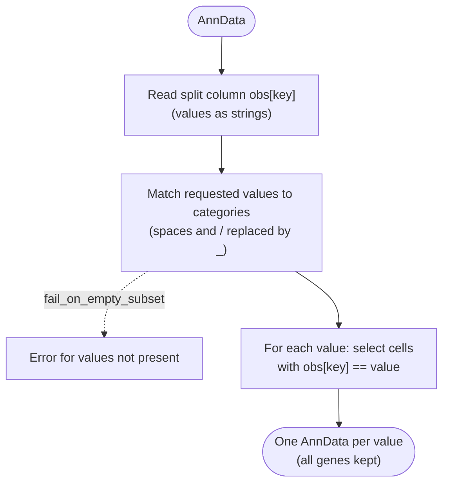

# Split Data

This module splits single-cell data (AnnData objects) into multiple files based on categorical values in the `.obs` metadata. Each requested value of the specified column becomes a separate output file.



*Conceptual overview of the main steps of the module. See the [functional description](#functional-description) below for details.*

## Functionality

The script:
- Reads an AnnData file (`.h5ad` or `.zarr` format)
- Splits cells based on a categorical column in `.obs`
- Outputs each subset as a separate `.zarr` file
- Supports both memory-based copying and efficient linked subsets
- Adds wildcard annotations to track split metadata

## Input Parameters

- `input`: Path to input AnnData file
- `key`: Column name in `.obs` to split by (passed as wildcard)
- `values`: List of specific values to extract (uses sanitized filenames)
- `dask`: Whether to keep arrays as dask arrays before writing copy (default: False)
- `fail_on_empty_subset`: Whether to raise an error when one or more requested `values` are not found in `key` (default: False)
- `write_copy`: Whether to write full copies vs linked subsets (default: False, auto-enabled for .h5ad inputs)
- `slots`: Optional mapping of slots to read/write

## Example Config

```yaml
output_dir: test/out
images: test/images

DATASETS:
  test:
    input:
      split_data:
        pbmc: test/input/pbmc68k.h5ad
    split_data:
      key: bulk_labels
      fail_on_empty_subset: true
      values:
        - CD4+_CD45RA+_CD25-_Naive_T
        - Dendritic
        - CD14+_Monocyte
        - CD19+_B
```

## Performance Notes

- For `.zarr` inputs with `write_copy=False`: Creates efficient linked subsets
- For `.h5ad` inputs: Always creates full copies due to format limitations
- Uses Dask for memory-efficient processing of large datasets when reading file (relevant when `write_copy=True` or `.h5ad` as input file)

## Functional description

### Inputs

* **File formats:** `.h5ad` or `.zarr`, configured under `input: split_data:` (see [architecture](https://scatlastb.readthedocs.io/en/latest/principles/architecture.html)).
* **`.obs[key]`** — column to split by (config `key`, becomes wildcard `key`). Values are compared as strings.
* **Config keys** (defaults as implemented): `values` (list, exploded into one wildcard `value` per entry), `fail_on_empty_subset` (`false`), `write_copy` (`false`; forced to `true` for `.h5ad` input), `dask` (`false`), `slots` (`{}` = all slots present in the file, determined with `check_slot_exists`), `threads` (`1`, Dask workers).
* Requested `values` are matched against *sanitised* category names, in which spaces and `/` are replaced by `_` (e.g. `CD4+/CD25 T Reg` → `CD4+_CD25_T_Reg`).

### Processing steps

1. **`split_data_split`** (script `scripts/split_anndata.py`, environment `scanpy`). One job per task × input file × `key`, writing all requested values at once.
   ```text
   slots = config slots or all existing slots
   excluded = ALL_SLOTS not in slots                     # will be absent from the output
   if not write_copy and slots is an identity mapping:
       read only obs, var, uns (everything else will be linked)
   else: read slots (+ uns), backed=True, dask=True
   obs[key] = obs[key].astype(str)
   name_map = {sanitise(v): v for v in unique values of obs[key]}
   if fail_on_empty_subset and some requested value not in name_map: raise ValueError
   for value in values:
       category = name_map.get(value, value)             # unknown values give an empty subset
       mask = obs[key] == category
       sub = adata[mask]
       uns['wildcards'] |= {split_data_key: key, split_data_value: category}
       if write_copy: write_zarr(sub.copy(), splits/.../value~<value>.zarr, compute=not dask)
       else:          write obs + uns + excluded slots, symlink all other slots of the input
                      and store the cell mask with them (write_zarr_linked(subset_mask=(mask, None)))
   touch <key>.done
   ```
2. **`split_data_link`** (script `scripts/link_zarr.py`, environment `scanpy`, local rule). One job per `value`: creates the final `value~<value>.zarr` directory and symlinks every top-level entry of the corresponding file in `splits/` into it (`link_zarr(overwrite=True)`); fails if the split file does not exist. This rule turns the single multi-output split job into one output file per wildcard combination so downstream modules can consume each split separately.

### Outputs

Relative to `<output_dir>/split_data/`:

* `splits/dataset~<dataset>/file_id~<file_id>/key~<key>/value~<value>.zarr` — the actual split objects; `splits/…/key~<key>.done` — completion flag.
* `dataset~<dataset>/file_id~<file_id>/key~<key>/value~<value>.zarr` — directory whose slots are symlinks to the split above (final output used downstream).
* Each split contains the selected cells, all genes, `.obs[key]` cast to string and `.uns['wildcards']['split_data_key' | 'split_data_value']`.
* Depending on `write_copy`, the split in `splits/` is either a full copy of the selected data or a linked subset of the original file (`.zarr` input with `write_copy: false`).

Example output for the configuration above (requested values are written with sanitised names, spaces and slashes replaced with underscores):

```shell
test/out/split_data
├── dataset~test
│   └── file_id~pbmc
│       └── key~bulk_labels
│           ├── value~CD14+_Monocyte.zarr
│           ├── value~CD19+_B.zarr
│           ├── value~CD4+_CD45RA+_CD25-_Naive_T.zarr
│           └── value~Dendritic.zarr      # slots are symlinks into splits/
├── input_files.tsv
└── splits
    └── dataset~test
        └── file_id~pbmc
            ├── key~bulk_labels
            │   ├── value~CD14+_Monocyte.zarr
            │   ├── ...
            │   └── value~Dendritic.zarr
            └── key~bulk_labels.done
```

### Environments

* [`scanpy`](https://github.com/HCA-integration/scAtlasTb/blob/main/envs/scanpy.yaml)
